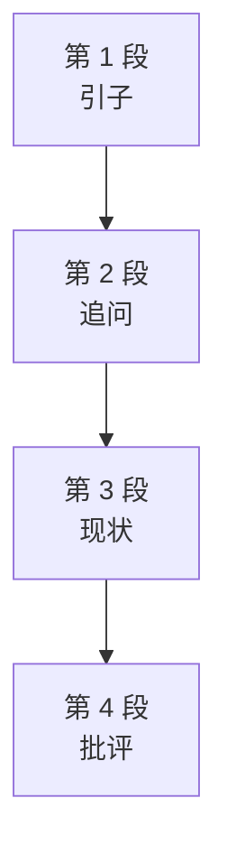

# Passage 55 · 智商测试：测得了类比，测不了爱与巧合

## 答题记录

| 轮次  | 日期         | 题号  | 正确  | 错误  | 正确率 | 用时    | 错题归因 |
| --- | --- | --- | --- | --- | --- | --- | --- |
| 1 |  | 1-5 |  |  |  |  |  |
| 2 |  | 1-5 |  |  |  |  |  |
| 3 |  | 1-5 |  |  |  |  |  |

> [!tip] 填写口径
> - **用时**以分钟计，只计做题时间，不含精读复盘。
> - **错题归因**填「题型·错误类型」，如：细节题·无中生有、细节题·混淆概念、细节题·与原文相反、猜词题·偷换概念、主旨题·局部夸大。
> - 纵向看趋势：正确率升而用时过长 → 熟练度不足；用时降而正确率波动 → 定位不稳。
> - 本篇 **5 题**，题号栏填 1-5；第 1 题是**细节题**；第 2 题是**推理题**；第 3 题是**原因细节题**；第 4 题是**结论题**；第 5 题是**态度题**。（本篇答案：1.D 2.C 3.A 4.A 5.B）

> [!info] 文章档案
> - **来源**：考研英语（一）2007 年 Text 2
> - **题材**：科学技术（智力测试 × 智商 × 心理学）
> - **结构**：4 段 / 18 句（5＋3＋5＋5）＋ 5 题（按句号断句与行首缩进实测；正文在 PDF p078 下半–p079 上半，题目在 p079，解析在 p193 右栏–p195 左栏）；**口径说明**：① 本书版面将真题原刊第 4 段（"Superhigh scores..." 段）与第 3 段连排（跨页处无段间空行），故本书第 3 段为 5 句，解析中「第三段④句」即 "Superhigh scores like vos Savant's..." 句，「第三段①②③句」依次为 The defining term...／The test comes primarily...／Generally costing...；② Q5 思路引作「第二段②句」，按本书第 2 段（3 句）实指①句 "Clearly, intelligence encompasses more than a score on a test."，系书中编号小误差，不影响答案；③ 其余书中引用（Q1「第一段③句」、Q2「第三段①②③句」、Q4「最后一段③④句」）均与本文编号一致。
> - **难度**：★★★☆☆
> - **一句话主旨**：智商测试（IQ testing）——它到底测什么（文字/图形类比、想象折叠、数字序列）、高智商专栏作家 Marilyn vos Savant 的困惑、计分规则从比率智商到离差智商的演变，以及心理学家 Sternberg 对其局限性的批评。

## 一、篇章脉络

- **第 1 段**：**引子，5 句**。周日报纸增刊《Parade》的「Ask Marilyn」专栏请读者向高智商女性 Marilyn vos Savant（IQ 228，史上最高）提问；可当普通人问「爱与喜欢有何不同」「运气与巧合的本质是什么」时，作者感到困惑——智商测试考查的图形与数字能力，与回答诗人和哲学家都回避不了的问题之间，看不出关联。
- **第 2 段**：**追问，3 句**。显然，智力包含的不止一次测试的分数。那么「聪明」究竟意味着什么？智力有多少可以被明确，又能从神经学、遗传学、计算机科学等学科中学到多少？
- **第 3 段**：**现状，5 句**。智力的界定性术语似乎仍是 IQ 分数。测试主要有斯坦福-比奈与韦氏两种量表（均有成人版与儿童版），价格数百美元，通常只由心理学家施测，但其变体充斥书店与网络。关键变化在计分：如今按同龄人群统计分布给分，vos Savant 式的超高分已不可能；而 SAT、GRE 等其他标准化测试涵盖了 IQ 测试的主要方面。
- **第 4 段**：**批评，5 句**。Sternberg 指出，标准化测试评估不了成功所需的全部要素——重分析与语言、轻创造与实践；且一旦群体或环境改变，预测力就下降（低压力下能预测领导力，高压力下竟负相关）；更何况应试技巧本身就很重要。

> [!tip] 行文逻辑
> 本文是「现象引题—追问本质—说明现状—集中批评」的科普评论结构。
> 智商测试测得了文字图形类比与数字推理，却测不了爱与巧合、创造力与实践智慧——计分规则可以封杀超高分，却封杀不了「一张试卷定智力」的质疑；对 IQ 测试，作者的姿态是「承认其用、怀疑其够」。

## 二、逐段精读

### 第 1 段 · 引子：高智商专栏作家的「超纲」提问

**原文**

① For the past several years, the Sunday newspaper supplement *Parade* has featured a column called "Ask Marilyn."
② People are invited to query Marilyn vos Savant, who at age 10 had tested at a mental level of someone about 23 years old; that gave her an IQ of 228—the highest score ever recorded.
③ IQ tests ask you to complete verbal and visual analogies, to envision paper after it has been folded and cut, and to deduce numerical sequences, among other similar tasks.
④ So it is a bit confusing when vos Savant fields such queries from the average Joe (whose IQ is 100) as, "What's the difference between love and fondness?" or "What is the nature of luck and coincidence?"
⑤ It's not obvious how the capacity to visualize objects and to figure out numerical patterns suits one to answer questions that have eluded some of the best poets and philosophers.

**译文**

① 过去几年，周日报纸增刊《Parade》开设了一个名为「Ask Marilyn」的专栏。
② 读者受邀向 Marilyn vos Savant 提问——她在 10 岁时接受测试，心智水平相当于 23 岁的人；这给了她 228 的智商，是有史以来记录的最高分。
③ 智商测试要求你完成文字和图形类比、想象纸张被折叠剪切后的样子、推导数字序列，以及其他类似的任务。
④ 因此，当 vos Savant 应对普通人（智商 100）提出的这类问题——「爱与喜欢有什么区别？」「运气与巧合的本质是什么？」——时，难免有点让人困惑。
⑤ 那种使物体形象化、找出数字规律的能力，如何能让人回答出连最优秀的诗人和哲学家都未能回答的问题，并不显而易见。

#### 本段重点词汇

| 单词 | 词性 | 文中意 | 拓展 | 文中用法 |
| --- | --- | --- | --- | --- |
| **supplement** | n. | 增刊，副刊 | supplement to... ……的增补；亦作动词「补充」 | the Sunday newspaper supplement Parade（周日报纸增刊《Parade》） |
| **feature** | vt. | 以……为特色，是……的特征 | feature an article 刊载一篇特稿；作名词指「特色/功能」 | has featured a column called "Ask Marilyn"（设有「Ask Marilyn」专栏） |
| **column** | n. | （报刊）专栏 | newspaper column 报纸专栏；a column of... 一列…… | a column called "Ask Marilyn"（名为「Ask Marilyn」的专栏） |
| **query** | vt./n. | 提问，询问 | answer queries 回答问题；in query of 询问 | are invited to query Marilyn vos Savant（受邀向 vos Savant 提问） |
| **mental** | adj. | 智力的，心理的 | mental level 心智水平；mental health 心理健康 | at a mental level of someone about 23 years old（心智水平相当于约 23 岁的人） |
| **record** | vt./n. | 记录；纪录 | break a record 破纪录；on record 有记录的 | the highest score ever recorded（有史以来记录的最高分） |
| **verbal** | adj. | 言语的，文字的 | verbal ability 语言能力；与 nonverbal 相对 | complete verbal and visual analogies（完成文字和图形类比） |
| **visual** | adj. | 视觉的，图形的 | visual aids 直观教具；visualize 为其动词 | complete verbal and visual analogies（完成文字和图形类比） |
| **analogy** | n. | 类比，比拟 | draw an analogy between... 在……间作类比；by analogy 类推 | verbal and visual analogies（文字与图形类比） |
| **envision** | vt. | 想象，设想 | vision n. 想象力；envision doing sth 想象做某事 | to envision paper after it has been folded and cut（想象纸被折叠剪切后的样子） |
| **fold** | vt. | 折叠 | fold one's arms 双臂交叉；folding chair 折叠椅 | after it has been folded and cut（被折叠剪切之后） |
| **deduce** | vt. | 推导，演绎 | deduce... from... 从……推出……；deduction n. 推论 | to deduce numerical sequences（推导数字序列） |
| **numerical** | adj. | 数字的 | numerical order 数值顺序；number n. 数字 | deduce numerical sequences（推导数字序列） |
| **sequence** | n. | 序列，顺序 | in sequence 按顺序；a sequence of... 一连串…… | numerical sequences（数字序列） |
| **field** | vt. | 应对，处理（问题） | field questions/phone calls 接住问题/电话；作名词「田野；领域」 | when vos Savant fields such queries（当 vos Savant 应对这类问题时） |
| **average Joe** | 短语 | 普通人，平常人 | Joe 在美语口语中泛指「某人」；average adj. 平常的 | queries from the average Joe (whose IQ is 100)（智商 100 的普通人提出的问题） |
| **fondness** | n. | 喜爱，钟爱 | be fond of 喜爱；fondly adv. 深情地 | the difference between love and fondness（爱与喜欢的区别） |
| **coincidence** | n. | 巧合 | by coincidence 巧合地；coincide vi. 同时发生 | the nature of luck and coincidence（运气与巧合的本质） |
| **capacity** | n. | 能力 | the capacity to do sth 做某事的能力；capacity for... ……的容量/潜能 | the capacity to visualize objects（使物体形象化的能力） |
| **visualize** | vt. | 使形象化，想象 | visual adj. 视觉的；visualization n. 可视化 | to visualize objects and to figure out numerical patterns（使物体形象化并找出数字规律） |
| **figure out** |短语 | 想出，弄明白 | figure sb out 看透某人；figure on 指望 | to figure out numerical patterns（找出数字规律） |
| **pattern** | n. | 模式，规律 | behavior pattern 行为模式；pattern recognition 模式识别 | numerical patterns（数字规律） |
| **suit** | vt. | 适合，与……相称 | suit... to... 使……适合于……；be suited for 适合于 | how the capacity... suits one to answer questions（这种能力如何让人适于回答问题） |
| **elude** | vt. | 难倒，使无法解决 | elude sb （问题）难住某人；elude capture 逃脱追捕 | questions that have eluded some of the best poets and philosophers（难倒最优秀诗人和哲学家的问题） |

#### 长难句 · 本段第 ② 句

> [!abstract] 本段第 ② 句 · 原句
> People are invited to query Marilyn vos Savant, who at age 10 had tested at a mental level of someone about 23 years old; that gave her an IQ of 228—the highest score ever recorded.

**结构拆解**

- 主干：People are invited to query Marilyn vos Savant（invite sb to do sth 的**被动式**）
- `who at age 10 had tested at a mental level of someone about 23 years old`：**非限制性定语从句**修饰 vos Savant；had tested 是**过去完成时**（「测出心智水平」发生在「专栏邀请提问」这一现状之前）
- `that gave her an IQ of 228`：分号后的并列分句，that 回指「10 岁测出 23 岁心智水平」这一事实
- `—the highest score ever recorded`：**破折号同位语**，补充 228 的性质；ever recorded ＝ that has ever been recorded

**参考译文**

读者受邀向 Marilyn vos Savant 提问——她在 10 岁时接受测试，心智水平相当于 23 岁的人；这给了她 228 的智商，是有史以来记录的最高分。

> [!tip] 拆解要点
> ① 一句之内叠了三种补充手段——非限制性定语从句、分号并列、破折号同位，读时先抓主干 People are invited to query...，其余都是「追加说明」；② 过去完成时 had tested 提示「测智商」是先发生的事；③ 228 这个数字是第 3 题的题眼——后文会解释这类分数为何「不再可能」。

#### 长难句 · 本段第 ③ 句

> [!abstract] 本段第 ③ 句 · 原句
> IQ tests ask you to complete verbal and visual analogies, to envision paper after it has been folded and cut, and to deduce numerical sequences, among other similar tasks.

**结构拆解**

- 主干：IQ tests ask you to complete...（ask sb to do sth 结构）
- `to complete verbal and visual analogies`／`to envision paper...`／`to deduce numerical sequences`：**三个并列的不定式短语**作宾补，共同回答「IQ 测试让你做什么」
- `after it has been folded and cut`：**时间状语从句**（被动态），it 回指 paper
- `among other similar tasks`：范围状语，「在其他类似任务之中」

**参考译文**

智商测试要求你完成文字和图形类比、想象纸张被折叠剪切后的样子、推导数字序列，以及其他类似的任务。

> [!tip] 拆解要点
> ① 三个 to do 并列是第 1 题的题眼——D 项 words or graphs similar to the given ones 正是第一项任务「类比」的同义改写；② envision paper after it has been folded and cut 是「想象纸**被**折叠剪切后的样子」，B 项把它换成动手 folding or cutting——**被动语态一旦看成主动，动作主体就错了**；③ among other similar tasks 收尾，暗示测试任务远不止这三样，为后文的「测不全」批评埋伏笔。

#### 长难句 · 本段第 ④ 句

> [!abstract] 本段第 ④ 句 · 原句
> So it is a bit confusing when vos Savant fields such queries from the average Joe (whose IQ is 100) as, "What's the difference between love and fondness?" or "What is the nature of luck and coincidence?"

**结构拆解**

- 主干：it is a bit confusing（it 作**形式主语**，真正主语是后面的 when 从句）
- `when vos Savant fields such queries...`：**主语从句**；field 在此作动词，义为「应对、处理」
- `from the average Joe (whose IQ is 100)`：queries 的定语；括号内 whose 引导定语从句修饰 Joe
- `as, "What's...?" or "What is...?"`：as 引出 queries 的**同位语**（直接引语），把「这类问题」具体化

**参考译文**

因此，当 vos Savant 应对普通人（智商 100）提出的这类问题——「爱与喜欢有什么区别？」「运气与巧合的本质是什么？」——时，难免有点让人困惑。

> [!tip] 拆解要点
> ① it is confusing when... 是「形式主语＋when 主语从句」框架，when 从句往往较长，先抓框架再回头填内容；② field 是熟词僻义作动词「接住、应对（问题）」，不是「田野；领域」；③ as 引出的两个引语是第 1 题 A 项 philosophical questions 的出处——原文只说这些问题**出自专栏读者**，从未说智商测试要求回答它们，选项把「专栏收到的提问」偷换成「测试的考查项」。

#### 长难句 · 本段第 ⑤ 句

> [!abstract] 本段第 ⑤ 句 · 原句
> It's not obvious how the capacity to visualize objects and to figure out numerical patterns suits one to answer questions that have eluded some of the best poets and philosophers.

**结构拆解**

- 主干：It's not obvious（it 形式主语）＋ `how...`**主语从句**
- 从句主干：the capacity... suits one to answer questions
- `to visualize objects and to figure out numerical patterns`：capacity 的**后置定语**（两个并列不定式）
- `that have eluded some of the best poets and philosophers`：questions 的**定语从句**；elude ＝「难倒、使无法解决」

**参考译文**

那种使物体形象化、找出数字规律的能力，如何能让人回答出连最优秀的诗人和哲学家都未能回答的问题，并不显而易见。

> [!tip] 拆解要点
> ① 嵌套三层：形式主语 → how 主语从句 → that 定语从句，抓主干时只需记住 the capacity suits one to answer questions；② elude 的方向是「问题难倒人」（问题作主语、人作宾语），与 escape（逃脱）同源；③ 本句是全文「问题意识」的落脚点——测得了图形与数字，测不了爱与巧合，为第 2 段的追问和第 4 段的批评埋线。

### 第 2 段 · 追问：智力显然不止一张试卷的分数

**原文**

① Clearly, intelligence encompasses more than a score on a test.
② Just what does it mean to be smart?
③ How much of intelligence can be specified, and how much can we learn about it from neurology, genetics, computer science and other fields?

**译文**

① 显然，智力所包含的不止是一次测试的分数。
② 聪明究竟意味着什么？
③ 智力中有多少可以被明确说明？我们又能从神经学、遗传学、计算机科学和其他领域中学到多少？

#### 本段重点词汇

| 单词 | 词性 | 文中意 | 拓展 | 文中用法 |
| --- | --- | --- | --- | --- |
| **encompass** | vt. | 包含，包括 | encompass... and... 涵盖……与……；encompassing adj. 包罗万象的 | intelligence encompasses more than a score on a test（智力包含的不止一次测试的分数） |
| **score** | n. | 分数，得分 | IQ score 智商分数；test scores 测试分数 | more than a score on a test（不止一次测试的分数） |
| **smart** | adj. | 聪明的 | smart phone 智能手机；clever 同义但略带「机灵」义 | what does it mean to be smart?（聪明意味着什么？） |
| **specify** | vt. | 明确说明，具体规定 | as specified 按规定；specific adj. 具体的 | How much of intelligence can be specified（智力中有多少可以被明确说明） |
| **neurology** | n. | 神经学，神经病学 | neurological adj. 神经学的；neuro- 前缀表「神经」 | learn about it from neurology（从神经学中了解它） |
| **genetics** | n. | 遗传学 | genetic adj. 遗传的；gene n. 基因 | learn about it from... genetics（从遗传学中了解它） |

#### 长难句 · 本段第 ③ 句

> [!abstract] 本段第 ③ 句 · 原句
> How much of intelligence can be specified, and how much can we learn about it from neurology, genetics, computer science and other fields?

**结构拆解**

- and 连接**两个并列的特殊疑问句**：`How much of intelligence can be specified`（被动）＋ `how much can we learn about it from...`（主动）
- `of intelligence`：how much 的后置定语，「智力中有多少」
- `from neurology, genetics, computer science and other fields`：第二分句的**来源状语**，四个并列学科

**参考译文**

智力中有多少可以被明确说明？我们又能从神经学、遗传学、计算机科学和其他领域中学到多少？

> [!tip] 拆解要点
> ① and 连接的两个问句是「排比追问」——作者用问句而非陈述句推进思考，是科普评论的常用笔法；② specify 比 say 正式，指「明确、具体地界定」，与第 3 段 defining term（界定性术语）首尾呼应；③ 三个学科（神经学、遗传学、计算机科学）正是认知科学的三条腿——2007 年作者已预告智力研究的跨学科走向。

### 第 3 段 · 现状：IQ 分数仍是术语，计分规则却已换代

**原文**

① The defining term of intelligence in humans still seems to be the IQ score, even though IQ tests are not given as often as they used to be.
② The test comes primarily in two forms: the Stanford-Binet Intelligence Scale and the Wechsler Intelligence Scales (both come in adult and children's versions).
③ Generally costing several hundred dollars, they are usually given only by psychologists, although variations of them populate bookstores and the World Wide Web.
④ Superhigh scores like vos Savant's are no longer possible, because scoring is now based on a statistical population distribution among age peers, rather than simply dividing the mental age by the chronological age and multiplying by 100.
⑤ Other standardized tests, such as the Scholastic Assessment Test (SAT) and the Graduate Record Exam (GRE), capture the main aspects of IQ tests.

**译文**

① 在人类中，智力的界定性术语似乎仍然是智商分数，尽管智商测试已经不像过去那样常用了。
② 这类测试主要有两种形式：斯坦福-比奈智力量表和韦氏智力量表（两者都有成人版和儿童版）。
③ 一般来说，它们要花费数百美元，通常只由心理学家施测，不过它们的各种变体却充斥着书店和互联网。
④ 像 vos Savant 那样的超高分已经不可能再出现了，因为现在的计分是以同龄群体中的人口统计分布为基础的，而不是简单地把心理年龄除以实际年龄再乘以 100。
⑤ 其他标准化测试，比如学术能力评估测验（SAT）和研究生入学考试（GRE），涵盖了智商测试的主要方面。

#### 本段重点词汇

| 单词 | 词性 | 文中意 | 拓展 | 文中用法 |
| --- | --- | --- | --- | --- |
| **defining** | adj. | 界定性的，起决定作用的 | define vt. 定义；the defining moment 决定性时刻 | The defining term of intelligence in humans（人类智力的界定性术语） |
| **primarily** | adv. | 主要地 | primary adj. 首要的；primarily due to 主要由于 | The test comes primarily in two forms（这类测试主要有两种形式） |
| **scale** | n. | 量表；规模 | intelligence scale 智力量表；on a large scale 大规模 | the Stanford-Binet Intelligence Scale（斯坦福-比奈智力量表） |
| **version** | n. | 版本 | adult and children's versions 成人版与儿童版；version 2.0 2.0 版 | both come in adult and children's versions（两者都有成人版和儿童版） |
| **generally** | adv. | 通常，一般来说 | generally speaking 一般而言；in general 同义 | Generally costing several hundred dollars（一般来说要花费数百美元） |
| **psychologist** | n. | 心理学家 | psychology n. 心理学；-logist 后缀表「……学家」 | given only by psychologists（只由心理学家施测） |
| **variation** | n. | 变体，变化 | variations of... ……的变体；vary vi. 变化 | variations of them populate bookstores（它们的各种变体充斥书店） |
| **populate** | vt. | 充斥，遍布于 | populate the Web 遍布网络；populated adj. 人口稠密的 | variations of them populate bookstores and the World Wide Web（变体充斥书店与互联网） |
| **superhigh** | adj. | 超高的 | super- 前缀表「超」；superhigh score 超高分 | Superhigh scores like vos Savant's（像 vos Savant 那样的超高分） |
| **statistical** | adj. | 统计的，统计学的 | statistical distribution 统计分布；statistics n. 统计学 | a statistical population distribution among age peers（同龄群体中的人口统计分布） |
| **distribution** | n. | 分布 | normal distribution 正态分布；distribute vt. 分配 | a statistical population distribution（人口统计分布） |
| **peer** | n. | 同龄人，同辈 | peer pressure 同伴压力；peer group 同龄群体 | among age peers（在同龄人之中） |
| **chronological** | adj. | 按年龄的，按时间顺序的 | chronology n. 年表；chronological age 实足年龄 | dividing the mental age by the chronological age（心理年龄除以实际年龄） |
| **multiply** | vt. | 乘以，使相乘 | multiply A by B 用 A 乘以 B；multiplication n. 乘法 | multiplying by 100（乘以 100） |
| **standardized** | adj. | 标准化的 | standardized tests 标准化测试；standard n./vt. 标准/使标准化 | Other standardized tests, such as...（其他标准化测试，比如……） |
| **capture** | vt. | 捕捉，涵盖 | capture the main aspects 涵盖主要方面；capture attention 吸引注意 | capture the main aspects of IQ tests（涵盖智商测试的主要方面） |
| **aspect** | n. | 方面 | every aspect of... ……的每个方面；in all aspects 全方位 | the main aspects of IQ tests（智商测试的主要方面） |

#### 长难句 · 本段第 ① 句

> [!abstract] 本段第 ① 句 · 原句
> The defining term of intelligence in humans still seems to be the IQ score, even though IQ tests are not given as often as they used to be.

**结构拆解**

- 主干：The defining term... still seems to be the IQ score（seem to be ＝「似乎是」）
- `of intelligence in humans`：term 的**后置定语**
- `even though IQ tests are not given as often as they used to be`：**让步状语从句**；as often as 是比较结构，used to be 后省略了重复的 given（＝as they used to be given）

**参考译文**

在人类中，智力的界定性术语似乎仍然是智商分数，尽管智商测试已经不像过去那样常用了。

> [!tip] 拆解要点
> ① even though 让步从句与主句的 still 构成「虽然……仍然……」框架——still/often 这类「延续性词」是段落主旨信号；② 比较结构 as... as 中第二个 as 后常省略重复动词，还原为 as they used to be given 更易懂；③ defining 是 define 的分词形容词「界定性的」——第 3 题 D 项 defining characteristic 正是拿它做「原词重现却答非所问」的干扰。

#### 长难句 · 本段第 ③ 句

> [!abstract] 本段第 ③ 句 · 原句
> Generally costing several hundred dollars, they are usually given only by psychologists, although variations of them populate bookstores and the World Wide Web.

**结构拆解**

- 主干：they are usually given only by psychologists（被动；they 回指上句的两种量表）
- `Generally costing several hundred dollars`：**评注性现在分词短语**，逻辑主语＝they，相当于 Which generally cost...／Generally speaking, they cost...
- `although variations of them populate bookstores and the World Wide Web`：**让步状语从句**；populate 本义「居住于」，此处引申为「充斥着、遍布于」

**参考译文**

一般来说，它们要花费数百美元，通常只由心理学家施测，不过它们的各种变体却充斥着书店和互联网。

> [!tip] 拆解要点
> ① 分词短语放句首作「评注」是考研高频句式，逻辑主语必须与主句主语一致（都是 they＝tests）；② only 是被动句里的限定词——「只由心理学家施测」的 only 是第 2 题的隐含背景：正式测试门槛高，网上流传的多是变体；③ populate 由「（人口）居住」引申为「充斥」，常用于「某物遍布某地」：variations populate bookstores and the Web。

#### 长难句 · 本段第 ④ 句

> [!abstract] 本段第 ④ 句 · 原句
> Superhigh scores like vos Savant's are no longer possible, because scoring is now based on a statistical population distribution among age peers, rather than simply dividing the mental age by the chronological age and multiplying by 100.

**结构拆解**

- 主干：Superhigh scores... are no longer possible（no longer ＝「不再」）
- `like vos Savant's`：scores 的后置定语（介词短语）
- `because scoring is now based on a statistical population distribution among age peers`：**原因状语从句**（被动）
- `rather than simply dividing the mental age by the chronological age and multiplying by 100`：**rather than 平行结构**，与 is based on 构成对照——「而不是……」；dividing/multiplying 的逻辑主语是 scoring（旧算法的执行者）

**参考译文**

像 vos Savant 那样的超高分已经不可能再出现了，因为现在的计分是以同龄群体中的人口统计分布为基础的，而不是简单地把心理年龄除以实际年龄再乘以 100。

> [!tip] 拆解要点
> ① 本句是第 3 题的答案句：because 从句解释「为什么不再可能出现超高分」——**计分规则从「比率智商」（心理年龄÷实际年龄×100）变成了「离差智商」（同龄人群常模比较）**；② rather than 是「取舍型」对比，rather than 之后的 dividing... multiplying... 正是被否定的旧算法；③ 旧算法按比率，儿童极易刷出超高分（10 岁有 23 岁心智 → 230），新算法按同龄常模，超高分被正态分布封顶——这就是 228 成为绝唱的技术原因。

### 第 4 段 · 批评：Sternberg 指出的四层局限

**原文**

① Such standardized tests may not assess all the important elements necessary to succeed in school and in life, argues Robert J. Sternberg.
② In his article "How Intelligent Is Intelligence Testing?", Sternberg notes that traditional tests best assess analytical and verbal skills but fail to measure creativity and practical knowledge, components also critical to problem solving and life success.
③ Moreover, IQ tests do not necessarily predict so well once populations or situations change.
④ Research has found that IQ predicted leadership skills when the tests were given under low-stress conditions, but under high-stress conditions, IQ was negatively correlated with leadership—that is, it predicted the opposite.
⑤ Anyone who has toiled through SAT will testify that test-taking skill also matters, whether it's knowing when to guess or what questions to skip.

**译文**

① Robert J. Sternberg 指出，这类标准化测试可能无法评估在学校和生活中取得成功所需的所有重要要素。
② 在他的文章《智力测试有多聪明？》中，Sternberg 指出，传统测试最能评估分析能力和语言能力，却无法衡量创造力和实践性知识——而这两者同样是解决问题和人生成功的关键组成部分。
③ 此外，一旦群体或环境发生变化，智商测试就不一定能预测得那么准。
④ 研究发现，在低压力条件下施测时，智商能预测领导能力；但在高压力条件下，智商与领导能力呈负相关——也就是说，它预测的结果截然相反。
⑤ 任何一个苦熬过 SAT 的人都可以证明，应试技巧同样重要——不管是知道什么时候该猜，还是知道哪些题该跳过。

#### 本段重点词汇

| 单词 | 词性 | 文中意 | 拓展 | 文中用法 |
| --- | --- | --- | --- | --- |
| **assess** | vt. | 评估，评价 | assess one's ability 评估某人能力；assessment n. 评估 | may not assess all the important elements（可能无法评估所有重要要素） |
| **element** | n. | 要素，元素 | key elements 关键要素；chemical element 化学元素 | all the important elements necessary to succeed（取得成功所需的所有重要要素） |
| **analytical** | adj. | 分析型的，善于分析的 | analytical skills 分析能力；analyze vt. 分析 | best assess analytical and verbal skills（最能评估分析能力和语言能力） |
| **fail to** | 短语 | 未能做…… | fail to do sth 未能做成某事；failure n. 失败 | but fail to measure creativity and practical knowledge（却无法衡量创造力与实践知识） |
| **creativity** | n. | 创造力 | creative adj. 有创造力的；create vt. 创造 | fail to measure creativity（无法衡量创造力） |
| **practical** | adj. | 实用的，实践的 | practical knowledge 实践性知识；practice n. 实践 | creativity and practical knowledge（创造力和实践性知识） |
| **component** | n. | 组成部分 | components of... ……的组成部分；key component 关键部件 | components also critical to problem solving（对解决问题同样关键的组成部分） |
| **critical** | adj. | 至关重要的 | be critical to... 对……至关重要；critically adv. 关键地 | components also critical to problem solving and life success（对解决问题与人生成功同样关键的组成部分） |
| **moreover** | adv. | 此外，而且 | 表递进，相当于 in addition/what is more | Moreover, IQ tests do not necessarily predict so well（此外，智商测试未必预测得那么准） |
| **necessarily** | adv. | 必然地 | not necessarily 未必，不一定（阅读高频否定） | do not necessarily predict so well（不一定预测得那么准） |
| **predict** | vt. | 预测，预言 | predict leadership skills 预测领导能力；prediction n. 预测 | IQ predicted leadership skills（智商能预测领导能力） |
| **once** | conj. | 一旦 | once populations or situations change 一旦群体或环境变化；同类：the moment/as soon as | once populations or situations change（一旦群体或环境发生变化） |
| **leadership** | n. | 领导力，领导地位 | leadership skills 领导能力；leader n. 领导者 | IQ was negatively correlated with leadership（智商与领导能力呈负相关） |
| **negatively** | adv. | 负向地，消极地 | negatively correlated with 与……负相关；negative adj. 负的 | IQ was negatively correlated with leadership（智商与领导能力呈负相关） |
| **correlate** | vt. | 使相互关联 | correlate A with B 把 A 与 B 关联；correlation n. 相关性 | negatively correlated with leadership（与领导能力负相关） |
| **toil** | vi. | 辛苦劳作，苦干 | toil through sth 苦熬完某事；toil and moil 劳碌 | Anyone who has toiled through SAT（任何一个苦熬过 SAT 的人） |
| **testify** | vi. | 证明，作证 | testify that... 证明……；testify in court 出庭作证 | will testify that test-taking skill also matters（可以证明应试技巧同样重要） |
| **test-taking** | adj. | 应试的 | test-taking skills 应试技巧；take a test 参加考试 | test-taking skill also matters（应试技巧同样重要） |
| **skip** | vt. | 跳过，略过 | skip a question 跳过一题；skip breakfast 不吃早饭 | what questions to skip（哪些题该跳过） |

#### 长难句 · 本段第 ① 句

> [!abstract] 本段第 ① 句 · 原句
> Such standardized tests may not assess all the important elements necessary to succeed in school and in life, argues Robert J. Sternberg.

**结构拆解**

- **宾语前置的主谓倒装**：宾语 Such standardized tests... 提前至句首，谓语 argues Robert J. Sternberg 后置——正常语序为 Sternberg argues (that) such standardized tests may not assess...
- `necessary to succeed in school and in life`：elements 的**形容词短语后置定语**（＝that are necessary...）
- `may not`：情态动词否定，表「可能不」而非「一定不」

**参考译文**

Robert J. Sternberg 指出，这类标准化测试可能无法评估在学校和生活中取得成功所需的所有重要要素。

> [!tip] 拆解要点
> ① 「宾语前置＋谓语＋主语」的倒装是阅读长句的第一道坎——看到 argues/notes/says 这类动词出现在引语之后，先回头找它真正的主语；② necessary to succeed... 中 to succeed 的逻辑主语是「人」而不是 tests——「（人）取得成功所必需的要素」；③ may not 的「可能不」比 cannot 语气弱，为第 5 题作者「怀疑而非全盘否定」的态度定调。

#### 长难句 · 本段第 ② 句

> [!abstract] 本段第 ② 句 · 原句
> In his article "How Intelligent Is Intelligence Testing?", Sternberg notes that traditional tests best assess analytical and verbal skills but fail to measure creativity and practical knowledge, components also critical to problem solving and life success.

**结构拆解**

- 主干：Sternberg notes that...（that 引导**宾语从句**，一直延伸到句末）
- 从句内：traditional tests best assess analytical and verbal skills **but** fail to measure creativity and practical knowledge——but 连接两个对比谓语
- `components also critical to problem solving and life success`：creativity and practical knowledge 的**同位语**；critical 后置（＝that are also critical...）

**参考译文**

在他的文章《智力测试有多聪明？》中，Sternberg 指出，传统测试最能评估分析能力和语言能力，却无法衡量创造力和实践性知识——而这两者同样是解决问题和人生成功的关键组成部分。

> [!tip] 拆解要点
> ① but 是语义枢纽：assess A but fail to measure B，「测得好的」与「测不了的」形成清单式对照，直接支撑第 4 题；② 同位语 components also critical... 是「名词＋形容词后置」高频结构，be critical to ＝「对……至关重要」；③ 句尾 life success 与第 4 题 A 项 one's ability 构成「具体→抽象」的概括链，也是第 5 题态度证据之一。

#### 长难句 · 本段第 ④ 句

> [!abstract] 本段第 ④ 句 · 原句
> Research has found that IQ predicted leadership skills when the tests were given under low-stress conditions, but under high-stress conditions, IQ was negatively correlated with leadership—that is, it predicted the opposite.

**结构拆解**

- 主干：Research has found that...（that 宾语从句）
- 从句第一分句：IQ predicted leadership skills **when** the tests were given under low-stress conditions（时间状语从句＋被动）
- 从句第二分句（but 转折）：under high-stress conditions, IQ was negatively correlated with leadership
- `—that is, it predicted the opposite`：**破折号补充说明**，it 回指 IQ

**参考译文**

研究发现，在低压力条件下施测时，智商能预测领导能力；但在高压力条件下，智商与领导能力呈负相关——也就是说，它预测的结果截然相反。

> [!tip] 拆解要点
> ① when... but... 的「条件对照」是实证研究结论的标准句式：同一变量在不同条件下效果相反；② negatively correlated with ＝负相关（此涨彼跌），与 positively correlated with（正相关）相对——这是第 4 题 A 项「不可靠」的直接反证；③ that is 后的 it predicted the opposite 是作者替读者做的总结，读实验句时先找 that is，答案常在其前后。

## 三、全篇重点词汇汇总（自测用）

> 收录**全篇所有段落词汇，共 66 条，不删减**；按「逐段词汇表 → 本表」同源同序汇总，**跨段复现的词条只收入其首次出现的段落**（如 score 首现于第 2 段①句，第 1 段②句 the highest score ever recorded 与第 3 段①句 the IQ score 均为复现；standardized 首现于第 3 段⑤句，第 4 段①句 standardized tests 复现；test 词族全篇复现未收；SAT/GRE/Stanford-Binet/Wechsler 等专有名词未列入）。用法：遮住「词性」「所在段」两列自测。

| 单词 / 短语 | 词性 | 所在段 |
| --- | --- | --- |
| **supplement** | n. | 第 1 段 |
| **feature** | vt. | 第 1 段 |
| **column** | n. | 第 1 段 |
| **query** | vt./n. | 第 1 段 |
| **mental** | adj. | 第 1 段 |
| **record** | vt./n. | 第 1 段 |
| **verbal** | adj. | 第 1 段 |
| **visual** | adj. | 第 1 段 |
| **analogy** | n. | 第 1 段 |
| **envision** | vt. | 第 1 段 |
| **fold** | vt. | 第 1 段 |
| **deduce** | vt. | 第 1 段 |
| **numerical** | adj. | 第 1 段 |
| **sequence** | n. | 第 1 段 |
| **field** | vt. | 第 1 段 |
| **average Joe** | 短语 | 第 1 段 |
| **fondness** | n. | 第 1 段 |
| **coincidence** | n. | 第 1 段 |
| **capacity** | n. | 第 1 段 |
| **visualize** | vt. | 第 1 段 |
| **figure out** | 短语 | 第 1 段 |
| **pattern** | n. | 第 1 段 |
| **suit** | vt. | 第 1 段 |
| **elude** | vt. | 第 1 段 |
| **encompass** | vt. | 第 2 段 |
| **score** | n. | 第 2 段 |
| **smart** | adj. | 第 2 段 |
| **specify** | vt. | 第 2 段 |
| **neurology** | n. | 第 2 段 |
| **genetics** | n. | 第 2 段 |
| **defining** | adj. | 第 3 段 |
| **primarily** | adv. | 第 3 段 |
| **scale** | n. | 第 3 段 |
| **version** | n. | 第 3 段 |
| **generally** | adv. | 第 3 段 |
| **psychologist** | n. | 第 3 段 |
| **variation** | n. | 第 3 段 |
| **populate** | vt. | 第 3 段 |
| **superhigh** | adj. | 第 3 段 |
| **statistical** | adj. | 第 3 段 |
| **distribution** | n. | 第 3 段 |
| **peer** | n. | 第 3 段 |
| **chronological** | adj. | 第 3 段 |
| **multiply** | vt. | 第 3 段 |
| **standardized** | adj. | 第 3 段 |
| **capture** | vt. | 第 3 段 |
| **aspect** | n. | 第 3 段 |
| **assess** | vt. | 第 4 段 |
| **element** | n. | 第 4 段 |
| **analytical** | adj. | 第 4 段 |
| **fail to** | 短语 | 第 4 段 |
| **creativity** | n. | 第 4 段 |
| **practical** | adj. | 第 4 段 |
| **component** | n. | 第 4 段 |
| **critical** | adj. | 第 4 段 |
| **moreover** | adv. | 第 4 段 |
| **necessarily** | adv. | 第 4 段 |
| **predict** | vt. | 第 4 段 |
| **once** | conj. | 第 4 段 |
| **leadership** | n. | 第 4 段 |
| **negatively** | adv. | 第 4 段 |
| **correlate** | vt. | 第 4 段 |
| **toil** | vi. | 第 4 段 |
| **testify** | vi. | 第 4 段 |
| **test-taking** | adj. | 第 4 段 |
| **skip** | vt. | 第 4 段 |

> [!info] 说明
> - 本表与逐段词汇表**等长同源同序**：第 1 段 24 条 → 第 2 段 6 条 → 第 3 段 17 条 → 第 4 段 19 条，共 66 条。
> - **跨段复现只收首现段**：score（第 1 段②句 the highest score ever recorded、第 3 段①句 the IQ score）只收第 2 段；test/tests 词族（第 1 段③句、第 3 段①句、第 4 段①②⑤句）为基础词未收；standardized（第 3 段⑤句、第 4 段①句）只收第 3 段；assess（第 4 段①②句）只收第 4 段；skills（第 4 段②④句）未收。
> - 未收词说明：IQ／intelligence／test 等全文高频基础词，以及 Marilyn vos Savant、Parade、SAT、GRE、Stanford-Binet、Wechsler、Robert J. Sternberg 等专有名词未列入（背景见第四节「背景知识」）。

> [!example] 同义替换链（阅读题高频）
> - **类比任务**：complete verbal and visual analogies ↔ words or graphs similar to the given ones（第 1 题 D 项）
> - **想象 vs 动手**：envision paper after it has been folded and cut ↔ folding or cutting paper into different shapes（第 1 题 B 项陷阱：想象 ≠ 操作）
> - **版本差异**：both come in adult and children's versions ↔ the test contents and formats for adults and children may be different（第 2 题 C 项）
> - **变体 ≠ 更多版本**：variations of them populate bookstores and the Web ↔ more versions of IQ tests available on the Internet（第 2 题 B 项陷阱）
> - **不再可能**：are no longer possible ↔ can no longer achieve（第 3 题）
> - **算法变更**：scoring is now based on... rather than dividing... ↔ obtained through different computational procedures（第 3 题 A 项）
> - **预测力存疑**：do not necessarily predict so well ↔ may not be reliable indicators of one's ability（第 4 题 A 项）
> - **压力效应**：negatively correlated with leadership ↔ 分数不可靠的实证证据（第 4 题）
> - **不止于分数**：encompasses more than a score on a test ↔ 作者怀疑态度的证据（第 5 题）

## 四、知识点补充

> [!question] 背景知识
> - **Marilyn vos Savant 与「Ask Marilyn」专栏**：《Parade》杂志「Ask Marilyn」专栏长期由 Marilyn vos Savant 主答，她因 10 岁测出 228 的智商（本文数字）载入吉尼斯世界纪录。她最著名的事件是 1990 年在专栏中正确解答「蒙提霍尔问题」（三门问题），引来上万封读者信（其中不乏数学家）质疑，最终概率论与实验都证明她是对的——这段「普通人（甚至专家）向高智商者发问」的经历，正是本文引子的现实底色。
> - **比率智商 vs 离差智商**：1905 年法国 Binet-Simon 量表开心理测量先河；1916 年斯坦福大学的 Terman 修订版提出「比率智商」IQ ＝ 心理年龄 ÷ 实际年龄 × 100——儿童极易刷出高分。本文④句所说的旧算法即此。后改为「离差智商」：以同龄人群的正态分布为常模（均值 100、标准差约 15），分数只表示你在同龄人中的相对位置——这就是 vos Savant 式超高分「不再可能」的技术原因，也是第 3 题的答案所在。
> - **斯坦福-比奈与韦氏量表**：Stanford-Binet Intelligence Scale 1916 年首发，历经多次修订；Wechsler Intelligence Scales 自 1939 年起由 David Wechsler 编制，分成人（WAIS）、儿童（WISC）等版本，是全球使用最广的智力测验家族。两者均提供成人版与儿童版——第 2 题 C 项的出处。
> - **SAT 与 GRE**：美国大学入学考试与研究生入学考试，与 IQ 测试同属「标准化测验」家族（统一命题、常模比较）。文中第 4 段⑤句「苦熬过 SAT 的人」以亲历者口吻点出应试技巧的重要性。
> - **Robert J. Sternberg**：耶鲁大学心理学家，「成功智力」（successful intelligence）理论提出者，主张智力包含分析、创造与实践三个维度，远超 IQ 分数的单一衡量——第 4 段的批评即其观点的缩影，其文章题目 "How Intelligent Is Intelligence Testing?"（《智力测试有多聪明？》）本身就是对测试的尖锐反问。

> [!warning] 语法点
> - **非限制性定语从句＋分号并列＋破折号同位**：第 1 段②句一句之内三种补充手段叠加。
> - **形式主语 it ＋ when/how 主语从句**：第 1 段④句 it is a bit confusing when...、⑤句 It's not obvious how...。
> - **三个并列不定式作宾补**：第 1 段③句 to complete... / to envision... / to deduce...。
> - **even though 让步＋as... as 比较省略**：第 3 段①句 as they used to be (given)。
> - **rather than 取舍型平行结构**：第 3 段④句 is based on... rather than dividing...。
> - **评注性分词短语放句首**：第 3 段③句 Generally costing several hundred dollars（逻辑主语＝主句主语 they）。
> - **宾语前置的主谓倒装**：第 4 段①句 Such standardized tests may not assess..., argues Sternberg。
> - **名词＋形容词/分词后置定语**：elements necessary to succeed...（第 4 段①句）；components also critical to...（第 4 段②句）。
> - **negatively correlated with 搭配**：第 4 段④句，与 positively correlated with 相对。

> [!success] 写作可迁移句型
> - **媒体专栏引题**：For the past several years, X has featured a column called...（数年来，X 一直设有名为……的专栏）——用具体媒体场景带出抽象话题。
> - **让步承认再转折**：The defining term of... still seems to be..., even though...（……的界定性术语似乎仍是……，尽管……）——先立靶子、再行拆解。
> - **批评清单句式**：X best assess... but fail to measure..., components also critical to...（X 最擅长测……却测不了……，而后者对……同样关键）——用 but 制造对照清单。
> - **实验结论条件对照**：Research has found that A when..., but B under... conditions.（研究发现，在……条件下 A，但在……条件下 B。）
> - **问句排比推进**：Just what does it mean to...? How much of... can be...?（……究竟意味着什么？……中有多少可以……？）——用问句代替陈述，引导读者同思。

> [!danger] 易混辨析
> - **verbal vs visual vs oral**：verbal＝言语/文字的（与图形相对），visual＝视觉的/图形的，oral＝口头的——智商测试同时考 verbal 与 visual analogies。
> - **deduce vs induce vs deduct**：deduce＝演绎（由一般推个别），induce＝归纳（由个别推一般），deduct＝扣除——词形相近、意义各别。
> - **score 的两副面孔**：the highest score ever recorded 里 score＝「分数/纪录」，IQ score＝「智商分数」——同一个词贯穿第 1、2、3 段，是全文关键词。
> - **smart vs intelligent vs clever**：smart 口语化，intelligent 正式（名词 intelligence 的形容词），clever 侧重机灵（可含「小聪明」的贬义）。
> - **once conj. vs once adv.**：第 4 段③句 once populations or situations change 是连词「一旦」（与 the moment/as soon as 同类）；once 作副词是「曾经/一次」（once again）。
> - **正相关 vs 负相关**：positively correlated＝同涨同跌，negatively correlated＝此涨彼跌——文中高压条件下「智商越高、领导力越差」即负相关。
> - **predict vs forecast**：predict 指有依据的推断（可用于实验结论），forecast 多用于天气、行情等预报。
> - **fail to do vs fail in**：fail to measure＝「未能衡量」（不定式表结果），fail in the exam＝「考试不及格」。

## 五、题目分析

> [!info] 题目总览
> | 题号 | 题型 | 定位 | 答案 |
> | --- | --- | --- | --- |
> | 1 | 细节题 | 第 1 段③句 | D |
> | 2 | 推理题 | 第 3 段②句 | C |
> | 3 | 原因细节题 | 第 3 段④句 | A |
> | 4 | 结论题 | 第 4 段）③④句 | A |
> | 5 | 态度题 | 第 2 段①句 | B |

### 第 1 题 · 细节题：智商测试可能要求什么

> [!question] 原题
> 1. Which of the following may be required in an intelligence test?
> - A. Answering philosophical questions.
> - B. Folding or cutting paper into different shapes.
> - C. Telling the differences between certain concepts.
> - D. Choosing words or graphs similar to the given ones.

**正确答案**：**D. Choosing words or graphs similar to the given ones.（选择与所给项相似的词或图形）**

**定位与依据**

- 第 1 段③句——IQ tests ask you to complete verbal and visual analogies, to envision paper after it has been folded and cut, and to deduce numerical sequences, among other similar tasks。句中列出三类任务：文字/图形类比、想象折叠剪切后的纸、推导数字序列。D 项 Choosing words or graphs similar to the given ones 正是第一类任务「类比」的英文释义——挑出「相似的词语或图形」，故选 D。

**干扰项分析**

| 选项 | 选项内容 | 判断 | 排除理由 |
| --- | --- | --- | --- |
| A | 回答哲学问题 | ✗ | 「爱与喜欢」「运气与巧合」确在第 1 段④句出现，但那是「Ask Marilyn」专栏收到的普通人提问，并非智商测试的考查项——把「专栏问题」偷换成「测试任务」 |
| B | 把纸折叠或剪成不同形状 | ✗ | 偷换动作与语态：③句是 envision paper after it has been folded and cut（想象纸**被**折叠剪切后的样子），是脑内想象而非动手操作；选项换成主动的 folding or cutting |
| C | 辨别某些概念之间的差异 | ✗ | 第 1 段④句 What's the difference between love and fondness 是提问内容，不是测试任务；文中未提「辨别概念差异」这类题型 |
| D | 选出与所给词语或图形相似的词语或图形 | ✓ | ③句 verbal and visual analogies（文字与图形类比）的同义改写——analogy 的本质就是「找相似」 |

> [!tip] 解题思路
> ① 题干 may be required 对应原文 ask you to...，答案常是原文任务的**同义改写**而非原词复现；② B 项是「被动变主动」的经典错法：has been folded and cut → folding or cutting，动作发出者从「出卷情境」变成「应试者动手」；③ A/C 两个干扰项都能在第 1 段找到「熟人」（philosophical 对应 poets and philosophers；difference between concepts 对应 difference between love and fondness），但**词形现身不等于任务列举**，必须回③句的任务清单核对。

### 第 2 题 · 推理题：从第 3 段能推出什么

> [!question] 原题
> 2. What can be inferred about intelligence testing from Paragraph 3?
> - A. People no longer use IQ scores as an indicator of intelligence.
> - B. More versions of IQ tests are now available on the Internet.
> - C. The test contents and formats for adults and children may be different.
> - D. Scientists have defined the important elements of human intelligence.

**正确答案**：**C. The test contents and formats for adults and children may be different.（成人版与儿童版的测试内容与形式可能不同）**

**定位与依据**

- 第 3 段②句——The test comes primarily in two forms: the Stanford-Binet Intelligence Scale and the Wechsler Intelligence Scales (both come in adult and children's versions)。括号明说两种量表「都有成人版和儿童版」——同一量表区分成人与儿童版本，暗示其内容与形式可能不同，这正是 C 项的推断。

**干扰项分析**

| 选项 | 选项内容 | 判断 | 排除理由 |
| --- | --- | --- | --- |
| A | 人们不再把智商分数当作智力的指标 | ✗ | 与①句相悖：The defining term of intelligence... still seems to be the IQ score——「仍然是」；not given as often 说的是「不如过去常用」，不等于「不再用作指标」 |
| B | 现在网上有更多版本的智商测试 | ✗ | ③句只说 variations of them populate bookstores and the Web（各种变体充斥书店与网络），说的是「有变体」而非「更多版本」；More 属程度加码，原文无据 |
| C | 成人与儿童测试的内容和形式可能不同 | ✓ | ②句 both come in adult and children's versions 的合理推断——分版本即暗示差异，infer 题考的正是这种「言外之意」 |
| D | 科学家已经定义了人类智力的重要要素 | ✗ | 第 3 段通篇讲测试形式与计分，未提「科学家定义智力要素」；「重要要素」是第 4 段 Sternberg 的话题，张冠李戴 |

> [!tip] 解题思路
> ① infer 题的答案不是原文原句，而是**原文信息的合理延伸**——②句「有成人版和儿童版」推出「内容形式可能不同」，中间隔着一步常识推理；② A 项是最漂亮的陷阱：not given as often as they used to be（不如过去常用）≠ no longer use（不再使用），**频率下降不等于归零**；③ B 项演示「程度词加码」：variations（变体）→ More versions（更多版本），词换了、程度也偷换了。

### 第 3 题 · 原因细节题：为什么再难出现超高分

> [!question] 原题
> 3. People nowadays can no longer achieve IQ scores as high as vos Savant's because
> - A. the scores are obtained through different computational procedures.
> - B. creativity rather than analytical skills is emphasized now.
> - C. vos Savant's case is an extreme one that will not repeat.
> - D. the defining characteristic of IQ tests has changed.

**正确答案**：**A. the scores are obtained through different computational procedures.（分数通过不同的计算程序得出）**

**定位与依据**

- 第 3 段④句——Superhigh scores like vos Savant's are no longer possible, because scoring is now based on a statistical population distribution among age peers, rather than simply dividing the mental age by the chronological age and multiplying by 100。because 从句直接给出原因：现在按同龄人群统计分布计分，而非「心理年龄÷实际年龄×100」——算法换了，故选 A。

**干扰项分析**

| 选项 | 选项内容 | 判断 | 排除理由 |
| --- | --- | --- | --- |
| A | 分数通过不同的计算方法获得 | ✓ | ④句 because 从句的同义概括：scoring is now based on... rather than dividing... ＝ 计分程序由比率算法改为常模算法 |
| B | 现在强调创造力而非分析能力 | ✗ | 偷换话题：「创造力 vs 分析能力」是第 4 段 Sternberg 对传统测试缺点的批评，与「超高分不再可能」的原因无关 |
| C | vos Savant 的个案是个不会重现的极端 | ✗ | 同义反复：are no longer possible 的另一种说法就是「不会重现」，用它解释自己＝没解释；题干问 because，需要的是**技术原因** |
| D | 智商测试的界定性特征已经改变 | ✗ | 原词陷阱：defining term 出现在第 3 段①句（界定性术语**仍是** IQ 分数），选项把 defining characteristic 说成「已改变」，与原文相反 |

> [!tip] 解题思路
> ① because 题优先找原文的 because 从句——第 3 段④句的 because 从句就是答案本体，其余选项都是旁生枝节；② C 项是「同义反复不解释」的典型：把题干换种说法当理由，看到选项与题干同义要立刻警惕；③ D 项演示「原词重现＋语义反转」：defining 一词确实在原文出现，但原文说 defining term「仍然是」IQ score——**词在、意思反了**，这是考研阅读最高频的干扰手法。

### 第 4 题 · 结论题：从最后一段能得出什么

> [!question] 原题
> 4. We can conclude from the last paragraph that
> - A. test scores may not be reliable indicators of one's ability.
> - B. IQ scores and SAT results are highly correlated.
> - C. testing involves a lot of guesswork.
> - D. traditional tests are out of date.

**正确答案**：**A. test scores may not be reliable indicators of one's ability.（测试分数未必是能力的可靠指标）**

**定位与依据**

- 最后一段（第 4 段）③④句——IQ tests do not necessarily predict so well once populations or situations change（情境一变，预测力就下降）＋ Research has found that IQ predicted leadership skills under low-stress conditions, but under high-stress conditions, IQ was negatively correlated with leadership（低压下能预测、高压下竟反向预测）。两处证据共同指向：测试分数未必可靠，故选 A。

**干扰项分析**

| 选项 | 选项内容 | 判断 | 排除理由 |
| --- | --- | --- | --- |
| A | 测试分数可能不是个人能力的可靠指标 | ✓ | ③句 do not necessarily predict so well 的同义改写；④句「条件反转、预测反向」进一步佐证分数不可靠 |
| B | 智商分数和 SAT 成绩高度相关 | ✗ | 偷换概念：⑤句只说「苦熬过 SAT 的人证明应试技巧重要」，文中从未比较 IQ 分数与 SAT 成绩的相关性 |
| C | 测试涉及大量猜测 | ✗ | 以偏概全：⑤句 knowing when to guess 是 SAT 应试技巧的一个例子，不能推出「所有测试都涉及大量猜测」 |
| D | 传统测试已经过时 | ✗ | 过度推断：Sternberg 只说传统测试 fail to measure creativity and practical knowledge（有盲区），「有缺点」≠「过时」，作者未作此判断 |

> [!tip] 解题思路
> ① conclude 题的答案必须是**本段证据能支撑的概括**——A 项由③④句两层证据共同推出，其余三项都只搭上原文一个词；② B 项是最隐蔽的偷换：把⑤句「IQ 测试与 SAT 都考验应试技巧」偷换成「IQ 与 SAT 成绩相关」，**共享关键词 ≠ 存在关系**；③ D 项演示态度升级：fail to measure（有盲区）→ out of date（过时），批评的「程度」被悄悄放大。

### 第 5 题 · 态度题：作者对智商测试的态度

> [!question] 原题
> 5. What is the author's attitude towards IQ tests?
> - A. Supportive.
> - B. Skeptical.
> - C. Impartial.
> - D. Biased.

**正确答案**：**B. Skeptical.（怀疑的）**

**定位与依据**

- 全文立场句——第 2 段①句 Clearly, intelligence encompasses more than a score on a test（智力显然不止一张试卷的分数）；第 4 段①句 Such standardized tests may not assess all the important elements necessary to succeed（标准化测试可能评估不了成功所需的全部要素）；③句 IQ tests do not necessarily predict so well（预测力未必那么好）。三处「限定＋否定」层层递进，作者对智商测试明确持怀疑态度，故选 B。

**干扰项分析**

| 选项 | 选项内容 | 判断 | 排除理由 |
| --- | --- | --- | --- |
| A | 支持的 | ✗ | 全文找不到一处为智商测试辩护的表述；作者反复指出其盲区（creativity/practical knowledge）与不稳定性（条件下变、预测反转） |
| B | 怀疑的 | ✓ | 第 2 段①句 encompasses more than a score、第 4 段①句 may not assess all...、③句 do not necessarily predict 三处叠加，skeptical 是最准确的概括 |
| C | 公正的 | ✗ | 若为 impartial，作者应同时呈现支持与反对证据并保持中立——但第 1 段末句「并不显而易见」的质疑、第 4 段通篇批评，立场倾向明显 |
| D | 有偏见的 | ✗ | 态度题中「偏见」多为强贬义，通常先排除；作者的批评建立在实证研究之上（Research has found...），属「有据质疑」而非偏见 |

> [!tip] 解题思路
> ① 态度题先看「作者自己的判断句」——第 4 段虽引用 Sternberg，但第 2 段①句 Clearly... 是作者自己的话，且全文无一句为 IQ 测试翻案，可放心按作者态度作答；② 作者连用 may not／not necessarily 这类**弱化限定词**，语气是「质疑其充分性」而非「全盘否定」——所以选 skeptical 而非 biased；③ 选项词本身也可助排除：biased 带明显贬义，supportive 与全文批评基调相反，impartial 需要正反证据均衡——三者都可先出局。

## 六、复盘清单

- [ ] 合上书复述四段链条：专栏引子，228 高智商者答「超纲」问题（1 段）→ 智力不止于分数的追问（2 段）→ IQ 分数仍是界定术语、但计分规则已换代（3 段）→ Sternberg 的四层批评：测不全／轻创造与实践／情境变则预测降／应试技巧也重要（4 段）
- [ ] 复述第 1 题陷阱：B 项 envision（想象）→ folding or cutting（动手）的被动/主动错位；A/C 项「专栏问题」冒充「测试任务」
- [ ] 复述第 3 题算法对照：旧比率智商（心理年龄÷实际年龄×100）vs 新离差智商（同龄常模比较）→ A 项 different computational procedures
- [ ] 复述第 2 题推断法：both come in adult and children's versions →「内容与形式可能不同」；警惕 not given as often ≠ no longer use
- [ ] 复述第 4 题同义改写：do not necessarily predict so well ↔ may not be reliable indicators
- [ ] 过汇总表 66 词（逐段 24/6/17/19），遮住「所在段」列自测，重点过 7 个熟词僻义（feature 以……为特色／field 应对／score 分数／scale 量表／populate 充斥／once 一旦／critical 至关重要的）
- [ ] 复盘 5 题干扰项错法归类：偷换动作（Q1-B）、文中无据（Q1-C、Q2-D）、无中生有（Q2-B）、原词重现语义反转（Q3-D）、同义反复不解释（Q3-C）、偷换概念（Q4-B）、以偏概全（Q4-C）、过度推断（Q4-D）、态度词先排除（Q5-D）

## 七、关联笔记

- [[Passage53-机器人从灵巧工具到常识困境]]：同涉「单一指标衡量不了完整智能」——机器人缺常识，IQ 测试缺创造力与实践知识，两篇对照着读更能看清「技术能做什么、不能做什么」
- [[Passage49-被低估的才智]]：同论「才智被单一标准低估」——Sternberg 对传统智力观的批评与 Halpern 对「才智」定义的反思路径相近
- [[Passage54-个人搜索代理]]：同为「科学技术类」——上一篇讲算法对人的辅助，本篇讲标准化测试对人的「误判」，可对读「技术中立与否取决于用法」
- [[Passage31-梦可以被有意识地控制]]：均为认知/心理学实证研究发现类文章，可对读第 4 段「条件对照」的实验结论句式（when... but under...）

