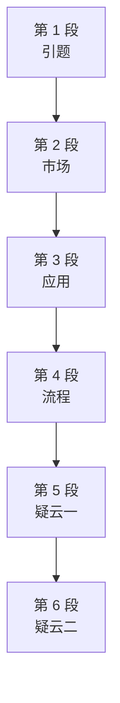

# Passage 57 · 亲子鉴定试剂盒：基因检测的热潮与疑云

## 答题记录

| 轮次  | 日期         | 题号  | 正确  | 错误  | 正确率 | 用时    | 错题归因 |
| --- | --- | --- | --- | --- | --- | --- | --- |
| 1 |  | 1-5 |  |  |  |  |  |
| 2 |  | 1-5 |  |  |  |  |  |
| 3 |  | 1-5 |  |  |  |  |  |

> [!tip] 填写口径
> - **用时**以分钟计，只计做题时间，不含精读复盘。
> - **错题归因**填「题型·错误类型」，如：细节题·无中生有、细节题·混淆概念、细节题·与原文相反、猜词题·偷换概念、主旨题·局部夸大。
> - 纵向看趋势：正确率升而用时过长 → 熟练度不足；用时降而正确率波动 → 定位不稳。
> - 本篇 **5 题**，题号栏填 1-5；第 1 题是**细节题**；第 2 题是**细节题**；第 3 题是**细节题**；第 4 题是**细节题**；第 5 题是**主旨题**。（本篇答案：1.A 2.C 3.D 4.A 5.B）

> [!info] 文章档案
> - **来源**：考研英语（一）2009 年 Text 2
> - **题材**：科学技术（基因检测 × 亲子鉴定 × DNA检测）
> - **结构**：6 段 / 17 句（2＋2＋2＋2＋5＋4）＋ 5 题（按句号断句与行首缩进实测；正文在 PDF p081 下半–p082 上半，解析在 p197 右栏–p198）；**口径说明**：本书版面把真题原刊的最后一段从 "Critics also argue..." 处**拆成两段**（第 5 段止于 "great-great-grandparents."，第 6 段起于 "Critics also argue"），故全书共 6 段；真题原刊为 5 段（"But some observers are skeptical" 至段末共 9 句一段）。书中解析 Q3 引「第五段②句 There's a kind of false precision...」、Q4 引「最后一段②句 Databases used by some companies...」均按本书 6 段版面自洽。另第 5 段末句跨页连排（p081 末行 "This DNA can reveal genetic information about only one or two" 接 p082 首行 "ancestors, even though..."，行首无缩进、无段间空行，属同段）。
> - **难度**：★★★☆☆
> - **一句话主旨**：基因检测——谚语「知子莫若父」开篇：只要花 30 美元买套亲子鉴定试剂盒（PTK）再花 120 美元取结果，父亲就能确认孩子是不是亲生的；PTK 无需处方、六万人购买、两打公司直销，亲子亲缘鉴定与家谱追根成为最热门应用；但怀疑者指出：血统检测兜售的是「虚假精确」，单追 Y 染色体或线粒体一条线看不到全貌，且各家参照数据库杂乱、算法专利化不经同行评审，结果因公司而异。

## 一、篇章脉络

- **第 1 段**：**引题，2 句**。谚语「知子莫若父」翻新——古代智慧父亲尚且未必识子，今天的男人却能花 30 美元买套亲子鉴定试剂盒（PTK）、再花 120 美元取结果，把父亲的「智慧」升级为科学确认。
- **第 2 段**：**市场，2 句**。 Identigene 的 COO Doug Fogg 称，去年 PTK 免处方上市以来已有 6 万多人购买；两打多家公司直接向公众直销 DNA 检测，价格从几百美元到 2500 美元以上不等。
- **第 3 段**：**应用，2 句**。最热门的两类是亲子/亲缘鉴定（被收养的孩子找亲生亲属、家庭追踪被送养的孩子）与家谱追根（热衷族谱者的新时尚，还撑起了一批查「家族地理根源」的生意）。
- **第 4 段**：**流程，2 句**。多数检测只需用棉签在口中刮取唾液细胞寄给公司；所有检测都需要一个待比对的候选对象。
- **第 5 段**：**疑云一，5 句**。纽约大学社会学家 Troy Duster 泼冷水：声称做血统检测的人兜售的是「虚假精确」——每个人的祖先数以百计，而多数血统检测只看一条线（父系的 Y 染色体或母系的线粒体 DNA），只能揭示一两位祖先的基因信息。
- **第 6 段**：**疑云二，4 句**。批评者接着说：商业基因检测的上限取决于它比对的参照库——各家数据库并非系统采集、而是把不同研究项目的数据囫囵归拢，导致某些地区数据多、某些地区没有，检测结果因处理公司而异；且公司用来评估亲缘关系的计算机程序可能已获专利，不经同行评审或外部评估。

> [!tip] 行文逻辑
> 本文是「引题—市场—应用—流程—疑云」的说明文结构，前四段铺陈事实、后两段集中质疑。
> 亲子鉴定试剂盒让「确认亲子关系」变成 150 美元的便利店商品，市场与用途一片火热；但怀疑者提醒：血统检测只追一条遗传线、参照库杂乱、算法不透明——商业基因检测卖得火，不等于测得准。

## 二、逐段精读

### 第 1 段 · 引题：30 美元买一个「确认」

**原文**

① It is a wise father that knows his own child, but today a man can boost his paternal (fatherly) wisdom—or at least confirm that he's the kid's dad.
② All he needs to do is shell out $30 for a paternity testing kit (PTK) at his local drugstore—and another $120 to get the results.

**译文**

① 聪明的父亲也未必了解自己的孩子，但今天，一个男人却可以提升他的父性智慧——或者至少确认，他就是孩子的父亲。
② 他所需要做的，只是在当地药店甩出 30 美元买一套亲子鉴定试剂盒（PTK）——再花 120 美元拿到结果。

#### 本段重点词汇

| 单词 | 词性 | 文中意 | 拓展 | 文中用法 |
| --- | --- | --- | --- | --- |
| **wise** | adj. | 智慧的，明智的 | a wise man 智者；wise decision 明智决定 | It is a wise father that knows his own child（聪明的父亲也未必了解自己的孩子） |
| **boost** | vt. | 提升，促进 | boost confidence 增强信心；boost the economy 刺激经济 | a man can boost his paternal (fatherly) wisdom（一个男人可以提升他的父性智慧） |
| **paternal** | adj. | 父亲的，父系的 | paternal instinct 父性本能；与 maternal（母系的）相对 | his paternal (fatherly) wisdom（他的父性智慧） |
| **fatherly** | adj. | 父亲般的 | fatherly advice 父亲般的忠告；fatherly love 父爱 | paternal (fatherly) wisdom（括号内同义注释） |
| **wisdom** | n. | 智慧 | conventional wisdom 传统观念；wisdom teeth 智齿 | boost his paternal wisdom（提升他的父性智慧） |
| **kid** | n. | 小孩，孩子 | kid brother 弟弟；no kidding 别开玩笑 | confirm that he's the kid's dad（确认他就是孩子的父亲） |
| **dad** | n. | 爸爸 | ＝daddy；口语中亦指「老爸」 | the kid's dad（孩子的爸爸） |
| **shell out** | 短语 | 支付，掏钱（常指不情愿地） | shell out money for sth 为某事掏钱；shell out $30 掏 30 美元 | shell out $30 for a paternity testing kit（甩出 30 美元买一套亲子鉴定试剂盒） |
| **paternity** | n. | 父亲身份，亲子关系 | paternity test 亲子鉴定；paternity leave 陪产假 | paternity testing kit (PTK)（亲子鉴定试剂盒） |
| **drugstore** | n. | 药店，（兼售杂货的）药房 | at the drugstore 在药店；美国 drugstore 亦卖日用品 | at his local drugstore（在他当地的药店） |

#### 长难句 · 本段第 ① 句

> [!abstract] 本段第 ① 句 · 原句
> It is a wise father that knows his own child, but today a man can boost his paternal (fatherly) wisdom—or at least confirm that he's the kid's dad.

**结构拆解**

- 主干 1：It is a wise father that knows his own child（谚语，**强调句型** It is... that...）
- 强调对象：a wise father（连这样聪明的父亲都未必识子）——本句型是**反讽式强调**：It is a wise man that... ＝「再聪明的人也难免……」
- 主干 2：a man can boost his paternal (fatherly) wisdom（but today 转折，boost ＝「提升」）
- `(fatherly)`：**括号同义注释**， paternal ＝ fatherly，帮读者扫清词障
- `—or at least confirm that he's the kid's dad`：**破折号补充**，or at least 退一步说；confirm 后是 that 宾语从句

**参考译文**

聪明的父亲也未必了解自己的孩子，但今天，一个男人却可以提升他的父性智慧——或者至少确认，他就是孩子的父亲。

> [!tip] 拆解要点
> ① 谚语 It is a wise father that knows his own child 不可按字面理解为「聪明的父亲了解自己的孩子」——**It is a wise man that... 是英语里固定反讽句型**，实指「再聪明的人也未必」（汉语对应「知子莫若父」的反用法，或「聪明一世，糊涂一时」）；② 破折号后的 or at least confirm 把 boost wisdom 落成可操作的动作，为②句的「花钱买确认」铺垫；③ 首段即点出全文双线索：一是亲子鉴定的**商品化**（便宜、便利），二是「确认」对**父亲身份焦虑**的回应。

#### 长难句 · 本段第 ② 句

> [!abstract] 本段第 ② 句 · 原句
> All he needs to do is shell out $30 for a paternity testing kit (PTK) at his local drugstore—and another $120 to get the results.

**结构拆解**

- 主干：All he needs to do is (to) shell out $30...（All 是句首主语，he needs to do 是**省略关系词的定语从句**）
- `is (to) shell out`：系动词后不定式作表语，**to 被省略**（主语含实义动词 do 时，表语不定式常省 to）
- `$30 for a paternity testing kit (PTK)`：shell out 的双宾语（钱＋物）；**PTK 是 paternity testing kit 的首字母缩写**，括号内给出全称
- `—and another $120 to get the results`：破折号追加第二笔开销，another $120 后省略了 shell out，不定式 to get the results 表目的

**参考译文**

他所需要做的，只是在当地药店甩出 30 美元买一套亲子鉴定试剂盒（PTK）——再花 120 美元拿到结果。

> [!tip] 拆解要点
> ① All (that) he needs to do is... 是高度口语化的「他所要做的全部就是……」句型，考研阅读中常把关系词 that 省掉；② 破折号内的 another $120 与前面的 $30 相加共 150 美元——**这个「白菜价」正是第 1 题 A 项 easy availability 的核心依据**；③ shell out 口语化表达「掏钱、甩出（钞票）」，暗含「花钱不心疼」的语气，与正式词 pay 的语体差异值得注意。

### 第 2 段 · 市场：免处方、六万人、两打公司

**原文**

① More than 60,000 people have purchased the PTKs since they first became available without prescriptions last year, according to Doug Fogg, chief operating officer of Identigene, which makes the over-the-counter kits.
② More than two dozen companies sell DNA tests directly to the public, ranging in price from a few hundred dollars to more than $2,500.

**译文**

① Identigene 的首席运营官 Doug Fogg 称，自从去年 PTK 首次免处方上市以来，已有 6 万多人购买；Identigene 正是生产这种非处方试剂盒的公司。
② 两打以上的公司直接向公众销售 DNA 检测，价格从几百美元到 2500 美元以上不等。

#### 本段重点词汇

| 单词 | 词性 | 文中意 | 拓展 | 文中用法 |
| --- | --- | --- | --- | --- |
| **purchase** | vt. | 购买（正式用语） | purchase a house 购房；purchasing power 购买力 | More than 60,000 people have purchased the PTKs（已有 6 万多人购买了 PTK） |
| **available** | adj. | 可获得的，可买到的 | become available 上市/可买到；available without a prescription 免处方 | since they first became available without prescriptions last year（自从去年 PTK 首次免处方上市以来） |
| **prescription** | n. | 处方，药方 | write a prescription 开处方；prescription drugs 处方药 | available without prescriptions（免处方） |
| **chief operating officer** | 短语 | 首席运营官（缩写 COO） | 与 CEO（首席执行官）、CFO（首席财务官）并列 | Doug Fogg, chief operating officer of Identigene（Identigene 的首席运营官 Doug Fogg） |
| **over-the-counter** | adj. | 非处方的，柜台的 | over-the-counter drugs 非处方药（缩写 OTC） | makes the over-the-counter kits（生产这种非处方试剂盒） |
| **directly** | adv. | 直接地 | sell directly to... 直接向……销售；direct adj. 直接的 | companies sell DNA tests directly to the public（公司直接向公众销售 DNA 检测） |
| **range** | vi. | （在一定范围内）变动 | range from... to... 从……到……不等；range in price 价格区间 | ranging in price from a few hundred dollars to more than $2,500（价格从几百美元到 2500 美元以上不等） |
| **dozen** | n. | 一打，十二 | dozens of 几十个；two dozen 两打 | More than two dozen companies（两打以上的公司） |

#### 长难句 · 本段第 ① 句

> [!abstract] 本段第 ① 句 · 原句
> More than 60,000 people have purchased the PTKs since they first became available without prescriptions last year, according to Doug Fogg, chief operating officer of Identigene, which makes the over-the-counter kits.

**结构拆解**

- 主干：More than 60,000 people have purchased the PTKs（现在完成时：从去年到现在「已购买」）
- `since they first became available without prescriptions last year`：since 引导的**时间状语从句**（与主句完成时呼应，指「自从免处方上市以来」）
- `according to Doug Fogg`：**介词短语作插入语**，标明消息来源
- `chief operating officer of Identigene`：Doug Fogg 的**同位语**，交代其身份
- `which makes the over-the-counter kits`：Identigene 的**非限制性定语从句**——公司「生产这种非处方试剂盒」

**参考译文**

Identigene 的首席运营官 Doug Fogg 称，自从去年 PTK 首次免处方上市以来，已有 6 万多人购买；Identigene 正是生产这种非处方试剂盒的公司。

> [!tip] 拆解要点
> ① 本句信息密度极高，但结构是「主干＋since 从句＋according to 插入语＋同位语＋定语从句」的线性叠加，按插入语切开即可分层读出；② without prescriptions（免处方）与 over-the-counter（非处方）是**同义互证**——普通处方药必须凭医生处方购买，PTK 却货架开放，这是「easy availability」的第二个证据（第一个是 $30 低价）；③ which makes... 这个从句悄悄交代了 Doug Fogg 的**利益相关身份**（他是生产商 COO），数据有营销动机，阅读时可留一分警惕。

#### 长难句 · 本段第 ② 句

> [!abstract] 本段第 ② 句 · 原句
> More than two dozen companies sell DNA tests directly to the public, ranging in price from a few hundred dollars to more than $2,500.

**结构拆解**

- 主干：More than two dozen companies sell DNA tests directly to the public（sell sb sth 双宾语结构）
- `directly`：副词作方式状语，「直接向公众」——**绕开医院、经销商，电商/药店铺货**
- `ranging in price from... to...`：**现在分词短语作伴随状语**，逻辑主语＝DNA tests（价格区间是检测的属性）
- `from a few hundred dollars to more than $2,500`：range 的**范围双端点**，低价到高价差近十倍

**参考译文**

两打以上的公司直接向公众销售 DNA 检测，价格从几百美元到 2500 美元以上不等。

> [!tip] 拆解要点
> ① ranging from A to B 是描述价格/规模/类型区间的万能结构，写作可直接迁移；② 句中 More than 60,000 people（①句）与 More than two dozen companies（②句）**用两个 more than 排叠出「需求旺＋供给多」的市场图景**，是作者论证「PTK 流行」的数据组合拳；③ 注意价格跨度之大（几百美元 vs 2500 美元以上）——第 1 题 B 项 flexibility in pricing 即由此设陷，但「价格档位多」不等于「定价灵活」，且题干问的是 1、2 段共同说明的特点，两段的共同落点是「买起来容易」（便宜＋免处方），不是价格策略。

### 第 3 段 · 应用：亲子亲缘鉴定与家谱追根

**原文**

① Among the most popular: **paternity** and kinship testing, which adopted children can use to find their biological relatives and families can use to track down kids put up for adoption.
② DNA testing is also the latest rage among passionate genealogists—and supports businesses that offer to search for a family's geographic roots.

**译文**

① 其中最热门的包括：亲子与亲缘鉴定——被收养的孩子可以用它来寻找有血缘关系的亲属，家庭也可以用它来追踪被送养的孩子。
② DNA 检测在热衷族谱研究的人群中也是最新时尚——还支撑起了一批提供「寻找家族地理根源」服务的生意。

#### 本段重点词汇

| 单词 | 词性 | 文中意 | 拓展 | 文中用法 |
| --- | --- | --- | --- | --- |
| **popular** | adj. | 受欢迎的，流行的 | among the most popular 最受欢迎的之一；popular with 受……欢迎 | Among the most popular: paternity and kinship testing（其中最热门的包括：亲子与亲缘鉴定） |
| **kinship** | n. | 亲属关系，血缘关系 | kinship testing 亲缘鉴定；ties of kinship 血缘纽带 | paternity and kinship testing（亲子与亲缘鉴定） |
| **adopted** | adj. | 被收养的 | adopted child 被收养的孩子；adopt vt. 收养 | which adopted children can use to find their biological relatives（被收养的孩子可以用它来寻找有血缘关系的亲属） |
| **biological** | adj. | 生物的，有血缘关系的 | biological parents 亲生父母；biological relatives 血亲 | find their biological relatives（寻找有血缘关系的亲属） |
| **relative** | n. | 亲属，亲戚 | close/distant relative 近/远亲；relatively adv. 相对地 | find their biological relatives（寻找有血缘关系的亲属） |
| **track down** | 短语 | 追踪到，追查 | track down a criminal 追捕罪犯；track down the source 溯源 | families can use to track down kids put up for adoption（家庭也可以用追踪被送养的孩子） |
| **put up for adoption** | 短语 | 送出供人收养 | put up for sale 拿出来卖（同构） | kids put up for adoption（被送养的孩子） |
| **rage** | n. | 时尚，风靡一时的事物 | the latest rage 最新时尚；all the rage 风靡一时 | the latest rage among passionate genealogists（热衷族谱研究者中的最新时尚） |
| **passionate** | adj. | 热情的，狂热的 | be passionate about 对……充满热情；passion n. 热情 | among passionate genealogists（在热衷族谱研究的人群中） |
| **genealogist** | n. | 家谱研究者，系谱学者 | genealogy n. 家谱学；家谱网站/DNA 家谱检测 | among passionate genealogists（在热衷族谱研究者中） |
| **geographic** | adj. | 地理的，地理位置的 | geographic roots 地理根源；geography n. 地理 | search for a family's geographic roots（寻找一个家族的地理根源） |
| **roots** | n. | 根，根源 | family roots 家族根源；take root 扎根 | a family's geographic roots（一个家族的地理根源） |

#### 长难句 · 本段第 ① 句

> [!abstract] 本段第 ① 句 · 原句
> Among the most popular: paternity and kinship testing, which adopted children can use to find their biological relatives and families can use to track down kids put up for adoption.

**结构拆解**

- 本句为**省略句／倒装结构**：Among the most popular: paternity and kinship testing ＝（The applications that are）among the most popular are...，冒号后直接点出对象
- `which adopted children can use to find their biological relatives and families can use to track down kids...`：testing 的**定语从句**，从句内部是**并列双谓语共享一个 which**：
  - which adopted children can use to find their biological relatives（被收养的孩子 → 找血亲）
  - （which）families can use to track down kids put up for adoption（家庭 → 追被送养的孩子）
- `put up for adoption`：kids 的**后置定语**（过去分词短语），「被送养的孩子」

**参考译文**

其中最热门的包括：亲子与亲缘鉴定——被收养的孩子可以用它来寻找有血缘关系的亲属，家庭也可以用追踪被送养的孩子。

> [!tip] 拆解要点
> ① 冒号开篇的省略句是说明文列举句式，功能等同于 The most popular are...，读时先把句子补全再理解；② 一个 which 带两个并列从句（adopted children can use... and families can use...）是本句难点——**第二分句的 which 承前省略**，若认不出会以为 relatives 和 families 是并列名词；③ 本句是第 2 题 C 项 identify parent-child kinship 的**直接出处**：paternity 与 kinship 两个词分别对应「亲子」与「亲缘」，而题干 PTK is used to 问的是「用途」，答案即此。

#### 长难句 · 本段第 ② 句

> [!abstract] 本段第 ② 句 · 原句
> DNA testing is also the latest rage among passionate genealogists—and supports businesses that offer to search for a family's geographic roots.

**结构拆解**

- 主干：DNA testing is also the latest rage among passionate genealogists（be the latest rage ＝「是最新时尚」）
- `among passionate genealogists`：介词短语作**范围状语**，限定流行圈层
- `—and supports businesses...`：破折号后**第二个谓语**（与 is 并列，共享主语 DNA testing）——检测不只是一种时尚，还「支撑起生意」
- `that offer to search for a family's geographic roots`：businesses 的**定语从句**，offer to do ＝「主动/承诺提供服务」

**参考译文**

DNA 检测在热衷族谱研究的人群中也是最新时尚——还支撑起了一批提供「寻找家族地理根源」服务的生意。

> [!tip] 拆解要点
> ① 破折号后的 supports businesses 是「and ＋第二谓语」结构，与①句的 is 并列——**科技潮流与商业利益在这里被缝在一起**，为后文批评「商业检测夸大其词」埋下伏笔；② the latest rage 是口语化表达「最新时尚、当红潮流」，与 rage（狂怒）的本义相差甚远，属**熟词僻义**；③ geographic roots（地理根源）与 genealogy（家谱）构成同义场——都指向「我从哪里来」的身份追问，这正是商业基因检测利用的情感痛点。

### 第 4 段 · 流程：棉签取样，比对候选

**原文**

① Most tests require collecting cells by swabbing saliva in the mouth and sending it to the company for testing.
② All tests require a potential candidate with whom to compare DNA.

**译文**

① 多数检测需要用棉签在口腔中刮取唾液细胞，并将其寄送给公司进行检测。
② 所有检测都需要一个潜在的比对对象，以便与之比对 DNA。

#### 本段重点词汇

| 单词 | 词性 | 文中意 | 拓展 | 文中用法 |
| --- | --- | --- | --- | --- |
| **collect** | vt. | 收集，采集 | collect data 收集数据；collect one's thoughts 定神 | require collecting cells（需要采集细胞） |
| **cell** | n. | 细胞 | cell division 细胞分裂；blood cell 血细胞 | collecting cells by swabbing saliva（通过刮取唾液来采集细胞） |
| **swab** | vt. | （用棉签）擦拭，涂抹 | swab the throat 擦拭喉咙；swab n. 棉签 | swabbing saliva in the mouth（在口腔中刮取唾液） |
| **saliva** | n. | 唾液 | ＝spit/drool 的近义术语；salivary adj. 唾液的 | swabbing saliva in the mouth（在口腔中刮取唾液） |
| **potential** | adj./n. | 潜在的；可能性 | potential candidate 潜在候选对象；potential problem 潜在问题 | require a potential candidate with whom to compare DNA（需要一个潜在的比对对象） |
| **candidate** | n. | 候选人，候选对象 | presidential candidate 总统候选人；candidate for the job 求职候选人 | a potential candidate（一个潜在的候选对象） |
| **compare** | vt. | 比较，比对 | compare A with B 把 A 与 B 比对；compare... to... 把……比作…… | with whom to compare DNA（以便与之比对 DNA） |

#### 长难句 · 本段第 ① 句

> [!abstract] 本段第 ① 句 · 原句
> Most tests require collecting cells by swabbing saliva in the mouth and sending it to the company for testing.

**结构拆解**

- 主干：Most tests require collecting cells... and sending it to the company...（require 后接**动名词**作宾语）
- 两个并列动名词短语共享 collecting 的「采集」语义场：
  - collecting cells by swabbing saliva in the mouth（by 表方式：**用棉签刮唾液的方式**采集细胞）
  - sending it to the company for testing（it 回指 cells；for testing 表目的）
- `by swabbing saliva in the mouth`：**介词短语作方式状语**，交代取样的具体操作

**参考译文**

多数检测需要用棉签在口腔中刮取唾液细胞，并将其寄送给公司进行检测。

> [!tip] 拆解要点
> ① require doing（＝require to be done）是高频考点：require collecting cells ＝需要被采集的细胞，**动名词的主动形式表被动意义**；② and sending 与 collecting 并列，中间隔了很长的 by 短语——**识别并列成分要先找连接词再回头看两端**；③ 流程之简单（自己刮刮嘴、寄个邮件）再次呼应「easy availability」，也反衬后文：取样这么随意，后面的数据库与算法却问题重重。

#### 长难句 · 本段第 ② 句

> [!abstract] 本段第 ② 句 · 原句
> All tests require a potential candidate with whom to compare DNA.

**结构拆解**

- 主干：All tests require a potential candidate（require 的宾语）
- `with whom to compare DNA`：**「介词＋关系代词＋不定式」结构**，相当于一个省略的定语从句（＝with whom the company can compare DNA）
- whom 指代 candidate（比对对象），with 来自 compare **with** 的固定搭配——**介词必须随比较动词前置**
- potential 的修饰重心在 candidate：「可能的、待定的」候选对象，而非「有潜力的」

**参考译文**

所有检测都需要一个潜在的比对对象，以便与之比对 DNA。

> [!tip] 拆解要点
> ① 「介词＋whom＋不定式」是书面语浓缩结构：with whom to compare DNA 一口气说清「工具（比对）＋对象（candidate）」，考研翻译高频；② 这句点出基因检测的方法论前提：**必须有参照物**——单份样本什么都证明不了，这个「必须比对」的要求正是第 6 段「参照库决定检测质量」的伏笔；③ compare 的搭配要记牢：compare A with B（同类比对）／compare A to B（异类比喻）。

### 第 5 段 · 疑云一：血统检测的「虚假精确」

**原文**

① But some observers are skeptical.
② "There's a kind of false precision being hawked by people claiming they are doing ancestry testing," says Troy Duster, a New York University sociologist.
③ He notes that each individual has many ancestors—numbering in the hundreds just a few centuries back.
④ Yet most ancestry testing only considers a single lineage, either the Y chromosome inherited through men in a father's line or mitochondrial DNA, which is passed down only from mothers.
⑤ This DNA can reveal genetic information about only one or two ancestors, even though, for example, just three generations back people also have six other great-great-grandparents or, four generations back, 14 other great-great-grandparents.

**译文**

① 但一些观察家持怀疑态度。
② 纽约大学社会学家 Troy Duster 说：「那些声称在做血统检测的人，兜售的是一种虚假的精确。」
③ 他指出，每个人都有许多祖先——仅仅回溯几个世纪，数目就以百计。
④ 然而，多数血统检测只看单一谱系：要么是父系中经男性遗传的 Y 染色体，要么是只由母亲传给的线粒体 DNA。
⑤ 这种 DNA 只能揭示一两位祖先的基因信息，然而，举例来说，仅回溯三代，人们就还有另外六位曾祖父母；回溯四代，则还有另外 14 位曾祖父母。

#### 本段重点词汇

| 单词 | 词性 | 文中意 | 拓展 | 文中用法 |
| --- | --- | --- | --- | --- |
| **observer** | n. | 观察家，观察者 | political observer 政治观察家；observe vt. 观察 | But some observers are skeptical（但一些观察家持怀疑态度） |
| **skeptical** | adj. | 持怀疑态度的 | be skeptical about/of 对……怀疑；skeptic n. 怀疑论者 | some observers are skeptical（一些观察家持怀疑态度） |
| **false** | adj. | 虚假的，错误的 | false precision 虚假的精确；false hope 虚幻的希望 | a kind of false precision（一种虚假的精确） |
| **precision** | n. | 精确，精准 | with precision 精确地；precise adj. 精确的 | a kind of false precision（一种虚假的精确） |
| **hawk** | vt. | 兜售，叫卖 | hawk one's wares 叫卖货物；hawk n. 鹰 | being hawked by people claiming they are doing ancestry testing（被那些声称在做血统检测的人兜售） |
| **claim** | vt. | 声称，主张 | claim to do/that 声称……；claim n. 主张 | people claiming they are doing ancestry testing（声称在做血统检测的人） |
| **ancestry** | n. | 血统，世系 | ancestry testing 血统检测；trace one's ancestry 追溯某人的血统 | they are doing ancestry testing（他们在做血统检测） |
| **sociologist** | n. | 社会学家 | sociology n. 社会学；sociological adj. 社会学的 | a New York University sociologist（一位纽约大学社会学家） |
| **individual** | n. | 个人，个体 | each individual 每个人；individual adj. 个体的 | each individual has many ancestors（每个人都有许多祖先） |
| **ancestor** | n. | 祖先 | ancestral adj. 祖传的；ancestry n. 世系 | has many ancestors（有许多祖先） |
| **lineage** | n. | 血统，谱系，一脉 | a single lineage 单一谱系；line n. 血统线 | most ancestry testing only considers a single lineage（多数血统检测只看单一谱系） |
| **chromosome** | n. | 染色体 | Y chromosome Y 染色体；chromosomal adj. 染色体的 | the Y chromosome inherited through men in a father's line（父系中经男性遗传的 Y 染色体） |
| **inherit** | vt. | 继承（遗传） | inherit from 从……继承；inheritance n. 遗传 | the Y chromosome inherited through men（经男性遗传的 Y 染色体） |
| **mitochondrial** | adj. | 线粒体的 | mitochondrial DNA（缩写 mtDNA）线粒体 DNA | or mitochondrial DNA（或是线粒体 DNA） |
| **genetic** | adj. | 基因的，遗传的 | genetic information 基因信息；genetics n. 遗传学 | reveal genetic information（揭示基因信息） |
| **generation** | n. | 一代人，世代 | three generations back 上溯三代；generation gap 代沟 | just three generations back（仅回溯三代） |

#### 长难句 · 本段第 ② 句

> [!abstract] 本段第 ② 句 · 原句
> "There's a kind of false precision being hawked by people claiming they are doing ancestry testing," says Troy Duster, a New York University sociologist.

**结构拆解**

- 主句（引语句）：There's a kind of false precision being hawked by people...（there be 句型，false precision 被兜售）
- `being hawked by people`：false precision 的**后置定语**（现在分词的被动式：正被兜售的）
- `claiming they are doing ancestry testing`：people 的**定语**（现在分词短语，claiming 后带宾语从句）
- 倒装引语结构：**宾语前置、says 主谓倒装**，says Troy Duster 嵌在引语之后；a New York University sociologist 是 Troy Duster 的**同位语**

**参考译文**

纽约大学社会学家 Troy Duster 说：「那些声称在做血统检测的人，兜售的是一种虚假的精确。」

> [!tip] 拆解要点
> ① false precision（虚假的精确）是全文题眼——检测给出的数字看似精确，实则只反映极小一部分遗传信息，「精确的形式、片面的实质」正是批评核心；② being hawked 用「兜售、叫卖」（hawk 本义「鹰」）作比喻，与③段 supports businesses 呼应：**商业动机让检测结论被包装得比实际更确定**；③ says 插入引语中间的倒装（"...," says X）是新闻写作规范句式，写作可迁移。

#### 长难句 · 本段第 ③ 句

> [!abstract] 本段第 ③ 句 · 原句
> He notes that each individual has many ancestors—numbering in the hundreds just a few centuries back.

**结构拆解**

- 主干：He notes that...（宾语从句）
- 从句：each individual has many ancestors（主谓宾齐全）
- `—numbering in the hundreds just a few centuries back`：**破折号补充**，逻辑上是独立主格／分词结构（＝ancestors number in the hundreds...），量化「many」：仅上溯几百年，祖先数已达数百

**参考译文**

他指出，每个人都有许多祖先——仅仅回溯几个世纪，数目就以百计。

> [!tip] 拆解要点
> ① number in the hundreds ＝「数以百计」，是新闻英语量化表达，与 hundreds of 语义相近但更精确；② 这句话是⑤句算术论证的前提：祖先数量随时间回溯**指数级翻倍**（三代添 6 位曾祖父母、四代添 14 位），而检测只看一两个人——**先立「基数大」，再打「覆盖面小」**，是典型的驳论铺垫。

#### 长难句 · 本段第 ④ 句

> [!abstract] 本段第 ④ 句 · 原句
> Yet most ancestry testing only considers a single lineage, either the Y chromosome inherited through men in a father's line or mitochondrial DNA, which is passed down only from mothers.

**结构拆解**

- 主干：Yet most ancestry testing only considers a single lineage（only 是逻辑重音：只看「一条」）
- `either the Y chromosome... or mitochondrial DNA`：lineage 的**同位语**，二选一说明「单一谱系」的两种形态
- `inherited through men in a father's line`：Y chromosome 的**后置定语**（过去分词短语）——经父系男性代代相传
- `which is passed down only from mothers`：mitochondrial DNA 的**非限制性定语从句**——只从母亲传下（pass down ＝世代相传）

**参考译文**

然而，多数血统检测只看单一谱系：要么是父系中经男性遗传的 Y 染色体，要么是只由母亲传给的线粒体 DNA。

> [!tip] 拆解要点
> ① either... or... 结构把「单线追溯」讲透：**Y 染色体走父线、线粒体 DNA 走母线**，两条线各管一边，其余全部祖先天量贡献的基因都被弃之不顾；② pass down 与 inherit 构成同义对：inherit 强调「继承」的动作主体（子代从父代得来），pass down 强调「往下传」的方向（父代传给子代）；③ 遗传学背景：Y 染色体几乎只由父亲传给儿子，线粒体 DNA 几乎只由母亲传给所有子女——所以一条谱系只能回答「父系或母系单边从哪里来」。

#### 长难句 · 本段第 ⑤ 句

> [!abstract] 本段第 ⑤ 句 · 原句
> This DNA can reveal genetic information about only one or two ancestors, even though, for example, just three generations back people also have six other great-great-grandparents or, four generations back, 14 other great-great-grandparents.

**结构拆解**

- 主干：This DNA can reveal genetic information about only one or two ancestors（only 与 one or two 双重压缩：只够看一两位）
- `even though..., for example, just three generations back...`：even though 引导的**让步状语从句**，中间插入 for example 与具体数字
- 从句内部：people also have six other great-great-grandparents or, four generations back, 14 other great-great-grandparents
  - 三代之上：还有 **6 位** other great-great-grandparents（高曾祖辈）
  - 四代之远：还有 **14 位** other great-great-grandparents
  - also / other 反复强调「检测范围之外的大多数」

**参考译文**

这种 DNA 只能揭示一两位祖先的基因信息，然而，举例来说，仅回溯三代，人们就还有另外六位曾祖父母；回溯四代，则还有另外 14 位曾祖父母。

> [!tip] 拆解要点
> ① 数字对比是本句全部说服力：**1–2 位 vs 6 位 vs 14 位**——检测揭示的信息量与祖先总量相比微不足道，even though 把反差推到最大；② great-great-grandparents 是「曾祖父母的父母」一辈（高曾祖辈），中文常译「曾祖父母」的扩展辈分，阅读时按辈分层级理解即可；③ 本句是第 3 题 D 项 achieve the claimed accuracy 的直接依据：商家宣称能追溯血统，实际只能覆盖九牛一毛——宣称的精度并未达到。

### 第 6 段 · 疑云二：参照库杂乱，算法不透明

**原文**

① Critics also argue that commercial genetic testing is only as good as the reference collections to which a sample is compared.
② Databases used by some companies don't rely on data collected systematically but rather lump together information from different research projects.
③ This means that a DNA database may have a lot of data from some regions and not others, so a person's test results may differ depending on the company that processes the results.
④ In addition, the computer programs a company uses to estimate relationships may be patented and not subject to peer review or outside evaluation.

**译文**

① 批评者还指出，商业基因检测的上限，取决于样本所比对的参照库。
② 一些公司使用的数据库并不依赖系统采集的数据，而是把不同研究项目的信息囫囵归拢到一起。
③ 这意味着，一个 DNA 数据库可能拥有大量来自某些地区的数据，却没有其他地区的数据，因此一个人的检测结果可能因处理结果的公司而异。
④ 此外，公司用来评估亲缘关系的计算机程序可能已获专利，且不经同行评审或外部评估。

#### 本段重点词汇

| 单词 | 词性 | 文中意 | 拓展 | 文中用法 |
| --- | --- | --- | --- | --- |
| **critic** | n. | 批评者，评论家 | harsh critic 严厉的批评者；film critic 影评人 | Critics also argue that...（批评者还指出……） |
| **commercial** | adj. | 商业的，营利的 | commercial value 商业价值；commercial break 广告时段 | commercial genetic testing（商业基因检测） |
| **reference** | n. | 参照，参考 | reference collections 参照库；with reference to 关于 | as good as the reference collections（上限取决于参照库） |
| **collection** | n. | 收藏物，集合 | data collection 数据收集；a large collection of 大量收藏的 | the reference collections to which a sample is compared（样本所比对的参照库） |
| **database** | n. | 数据库 | build a database 建数据库；database management 数据库管理 | Databases used by some companies（一些公司使用的数据库） |
| **rely on** | 短语 | 依赖，依靠 | rely on sb for sth 靠某人获得某物；reliant adj. 依赖的 | don't rely on data collected systematically（并不依赖系统采集的数据） |
| **systematically** | adv. | 系统地 | systematic adj. 系统的；collect data systematically 系统采集数据 | data collected systematically（系统采集的数据） |
| **lump together** | 短语 | 囫囵归拢，不加区分地放在一起 | lump A and B together 把 A 和 B 混为一谈 | lump together information from different research projects（把不同研究项目的信息囫囵归拢） |
| **differ** | vi. | 不同，相异 | differ from 与……不同；differ in 在……方面有异 | test results may differ（检测结果可能不同） |
| **process** | vt. | 处理，加工 | process data 处理数据；in-process 在制中的 | the company that processes the results（处理结果的公司） |
| **estimate** | vt. | 估计，估算 | estimate the cost 估算成本；estimation n. 估计 | to estimate relationships（评估亲缘关系） |
| **relationship** | n. | 关系，亲缘关系 | family relationships 亲属关系；＝relation 的近义 | estimate relationships（评估亲缘关系） |
| **patent** | vt./n. | 取得专利；专利 | patented drug 专利药；patent office 专利局 | may be patented（可能已获专利） |
| **subject** | adj. | 受……约束的，易遭……的 | be subject to 受制于……；subject to change 可能变更 | not subject to peer review or outside evaluation（不经同行评审或外部评估） |
| **peer review** | 短语 | 同行评审 | peer n. 同辈；peer-reviewed journal 同行评审期刊 | not subject to peer review（不经同行评审） |
| **evaluation** | n. | 评估，评价 | performance evaluation 绩效评估；evaluate vt. 评估 | outside evaluation（外部评估） |

#### 长难句 · 本段第 ① 句

> [!abstract] 本段第 ① 句 · 原句
> Critics also argue that commercial genetic testing is only as good as the reference collections to which a sample is compared.

**结构拆解**

- 主干：Critics also argue that...（宾语从句）
- 从句：commercial genetic testing is only as good as the reference collections
  - **only as good as... ＝「好不过……、上限由……决定」**（比较结构的特殊语义：A is only as good as B ⇒ A 的上限就是 B 的水平）
- `to which a sample is compared`：reference collections 的**定语从句**（介词 to 前置：be compared **to**）；「样本被拿来比对的那些参照库」

**参考译文**

批评者还指出，商业基因检测的上限，取决于样本所比对的参照库。

> [!tip] 拆解要点
> ① only as good as 是考研高频比较句型：字面「只有……那么好」，实为「成败全系于……」——本句中参照库的质量就是检测质量的天花板；② 介词前置的定语从句 to which... 比 which... to 更正式，判断介词能否前置的关键是**从句谓语与介词的固定搭配**（be compared to / with）；③ 本句是第 4 题的题眼：后面②③句全是「参照库怎么个乱法」（不系统采集、囫囵归拢、地区不均），所以题目问「商业基因检测面临的问题」，答案锁定数据收集杂乱。

#### 长难句 · 本段第 ③ 句

> [!abstract] 本段第 ③ 句 · 原句
> This means that a DNA database may have a lot of data from some regions and not others, so a person's test results may differ depending on the company that processes the results.

**结构拆解**

- 主干：This means that...（宾语从句）
- 从句 1：a DNA database may have a lot of data from some regions and not others
  - some... and not others ＝「有些地区有、有些地区没有」，**部分否定结构**
- `so a person's test results may differ...`：**so 引导的结果状语从句**（承接「数据不均 → 结果不稳」的因果链）
- `depending on the company that processes the results`：**现在分词短语作条件/依据状语**；其中 that processes the results 是 company 的定语从句
- 注意 results 一词在本句出现两次，含义不同：前指检测「结果」（对客户），后指公司「处理的数据产出」（对公司）——按语境区分

**参考译文**

这意味着，一个 DNA 数据库可能拥有大量来自某些地区的数据，却没有其他地区的数据，因此一个人的检测结果可能因处理结果的公司而异。

> [!tip] 拆解要点
> ① some... and not others 是「厚此薄彼」的紧凑表达，与②句 lump together 的信息混杂互为因果：**采集不系统 → 地区覆盖不均 → 换家公司就换个结论**；② depending on 短语把「客观差异」转写成「主观条件」——测出的「你从哪里来」居然取决于你花钱选了哪家公司，科学客观性被悄然消解；③ 句中两个 results 同词异义，读长难句时**同一个词重复出现要逐一还原指代**，这是避免理解漂移的基本功。

## 三、全篇重点词汇汇总（自测用）

> 收录**全篇所有段落词汇，共 69 条，不删减**；按「逐段词汇表 → 本表」同源同序汇总，**跨段复现的词条只收入其首次出现的段落**（如 paternity 首现于第 1 段②句，第 3 段①句复现；compare 首现于第 4 段②句，第 6 段①句 is compared 复现；result/results 全篇复现未收；Y chromosome／mitochondrial DNA／Identigene 等专名与缩写未列入）。用法：遮住「词性」「所在段」两列自测。

| 单词 / 短语 | 词性 | 所在段 |
| --- | --- | --- |
| **wise** | adj. | 第 1 段 |
| **boost** | vt. | 第 1 段 |
| **paternal** | adj. | 第 1 段 |
| **fatherly** | adj. | 第 1 段 |
| **wisdom** | n. | 第 1 段 |
| **kid** | n. | 第 1 段 |
| **dad** | n. | 第 1 段 |
| **shell out** | 短语 | 第 1 段 |
| **paternity** | n. | 第 1 段 |
| **drugstore** | n. | 第 1 段 |
| **purchase** | vt. | 第 2 段 |
| **available** | adj. | 第 2 段 |
| **prescription** | n. | 第 2 段 |
| **chief operating officer** | 短语 | 第 2 段 |
| **over-the-counter** | adj. | 第 2 段 |
| **directly** | adv. | 第 2 段 |
| **range** | vi. | 第 2 段 |
| **dozen** | n. | 第 2 段 |
| **popular** | adj. | 第 3 段 |
| **kinship** | n. | 第 3 段 |
| **adopted** | adj. | 第 3 段 |
| **biological** | adj. | 第 3 段 |
| **relative** | n. | 第 3 段 |
| **track down** | 短语 | 第 3 段 |
| **put up for adoption** | 短语 | 第 3 段 |
| **rage** | n. | 第 3 段 |
| **passionate** | adj. | 第 3 段 |
| **genealogist** | n. | 第 3 段 |
| **geographic** | adj. | 第 3 段 |
| **roots** | n. | 第 3 段 |
| **collect** | vt. | 第 4 段 |
| **cell** | n. | 第 4 段 |
| **swab** | vt. | 第 4 段 |
| **saliva** | n. | 第 4 段 |
| **potential** | adj./n. | 第 4 段 |
| **candidate** | n. | 第 4 段 |
| **compare** | vt. | 第 4 段 |
| **observer** | n. | 第 5 段 |
| **skeptical** | adj. | 第 5 段 |
| **false** | adj. | 第 5 段 |
| **precision** | n. | 第 5 段 |
| **hawk** | vt. | 第 5 段 |
| **claim** | vt. | 第 5 段 |
| **ancestry** | n. | 第 5 段 |
| **sociologist** | n. | 第 5 段 |
| **individual** | n. | 第 5 段 |
| **ancestor** | n. | 第 5 段 |
| **lineage** | n. | 第 5 段 |
| **chromosome** | n. | 第 5 段 |
| **inherit** | vt. | 第 5 段 |
| **mitochondrial** | adj. | 第 5 段 |
| **genetic** | adj. | 第 5 段 |
| **generation** | n. | 第 5 段 |
| **critic** | n. | 第 6 段 |
| **commercial** | adj. | 第 6 段 |
| **reference** | n. | 第 6 段 |
| **collection** | n. | 第 6 段 |
| **database** | n. | 第 6 段 |
| **rely on** | 短语 | 第 6 段 |
| **systematically** | adv. | 第 6 段 |
| **lump together** | 短语 | 第 6 段 |
| **differ** | vi. | 第 6 段 |
| **process** | vt. | 第 6 段 |
| **estimate** | vt. | 第 6 段 |
| **relationship** | n. | 第 6 段 |
| **patent** | vt./n. | 第 6 段 |
| **subject** | adj. | 第 6 段 |
| **peer review** | 短语 | 第 6 段 |
| **evaluation** | n. | 第 6 段 |

> [!info] 说明
> - 本表与逐段词汇表**等长同源同序**：第 1 段 10 条 → 第 2 段 8 条 → 第 3 段 12 条 → 第 4 段 7 条 → 第 5 段 16 条 → 第 6 段 16 条，共 69 条。
> - **跨段复现只收首现段**：paternity（第 1 段②句、第 3 段①句）只收第 1 段；compare（第 4 段②句、第 6 段①句 is compared）只收第 4 段；ancestry/ancestor 词族（ancestry testing 第 5 段复现三次、ancestor 第 5 段③⑤句）以 ancestry 与 ancestor 分别收入；result（第 1 段②句、第 6 段③句两次）未收（超基础词）。
> - 未收词说明：PTK（paternity testing kit 的缩写）、Identigene、Doug Fogg、Troy Duster、New York University、Y chromosome、mitochondrial DNA 等缩写、专名与人名未列入（背景见第四节「背景知识」）；DNA、test、company、data 等超基础词未收。

> [!example] 同义替换链（阅读题高频）
> - **便宜易得**：shell out $30... another $120 ↔ easy availability（第 1 题 A 项）
> - **免处方**：available without prescriptions ↔ over-the-counter kits ↔ easy availability（第 1 题）
> - **亲子亲缘**：paternity and kinship testing ↔ identify parent-child kinship（第 2 题 C 项）
> - **宣称的精度**：false precision ↔ claimed accuracy（第 3 题 D 项）
> - **单线追溯的局限**：a single lineage... only one or two ancestors ↔ fails to trace distant ancestors 的反面（第 3 题 A 项）
> - **数据收集杂乱**：don't rely on data collected systematically but rather lump together ↔ disorganized data collection（第 4 题 A 项）
> - **上限取决于参照库**：only as good as the reference collections ↔ 商业检测的问题出在数据（第 4 题）

## 四、知识点补充

> [!question] 背景知识
> - **谚语 It is a wise father that knows his own child**：与汉语「知子莫若父」表面同义，实为**反讽句型**——It is a wise man that... 意为「再聪明的人也难免……」，谚语的真正含义是「聪明的父亲也未必识子」。文章翻新这个谚语：古人只能凭智慧猜，今人可以花 150 美元科学确认。
> - **PTK 与 OTC 基因检测**：PTK（paternity testing kit）是亲子鉴定试剂盒的缩写，2000 年代中期起在美国药店、超市以 OTC（over-the-counter，非处方）形式销售，取样方式为口腔棉签（buccal swab），全程免去医院。文中 $30（试剂盒）＋$120（检测服务）的价格与 2009 年前后市场实价相符。
> - **Y 染色体与线粒体 DNA**：Y 染色体几乎只由父亲传给儿子，沿**父系单线**下传；线粒体 DNA 由母亲传给所有子女，沿**母系单线**下传。两者都不发生重组，是追溯单系祖先的理想标记——但也只能回答「父系/母系这一条线从哪来」，与全基因组 ancestry 分析（如 SNP 芯片）路径不同。这正是第 5 段④⑤句的批评对象。
> - **Troy Duster 与「虚假精确」**：Troy Duster 是纽约大学社会学教授，长期研究种族、基因与生物伦理（著有《Backdoor to Eugenics》），他对消费级基因检测的批评集中于「把概率性、选择性的数据包装成确定性的身份答案」。文中 false precision 一词即其核心立场。
> - **家谱热与基因族谱**：2000 年代中后期，23andMe（2006 年成立）、FamilyTreeDNA 等公司把「祖先成分分析」做成消费产品， genealogists（家谱研究者）成为最早的用户群之一，催生「遗传族谱学」（genetic genealogy）——第 3 段②句的 businesses that offer to search for a family's geographic roots 即指这类服务。
> - **同行评审（peer review）**：学术成果发表前由同领域匿名专家评审质量的制度，是科学共同体的质量闸门。第 6 段④句 not subject to peer review or outside evaluation 指商业公司的算法作为商业秘密/专利，不接受这种外部检验——**科学程序的黑箱化是商业检测可信度的软肋**。

> [!warning] 语法点
> - **It is a wise man that... 反讽强调句**：第 1 段①句，被强调部分是「聪明人」，语义却指向反面（再聪明也难免）。
> - **All (that) he needs to do is (to) shell out...**：第 1 段②句，主语含实义动词 do 时，表语不定式省 to。
> - **according to ＋同位语＋ which 定语从句**：第 2 段①句，消息来源、身份、公司业务三层信息叠加。
> - **ranging in price from... to...**：第 2 段②句，现在分词短语作伴随状语。
> - **冒号列举省略句**：第 3 段①句 Among the most popular: paternity and kinship testing。
> - **一个 which 带两个并列分句**：第 3 段①句 which adopted children can use... and (which) families can use...。
> - **require doing 表被动**：第 4 段①句 require collecting cells（＝cells need to be collected）。
> - **介词＋whom＋不定式**：第 4 段②句 with whom to compare DNA。
> - **there be ＋现在分词被动式作后置定语**：第 5 段②句 false precision being hawked。
> - **either... or... 同位二选一**：第 5 段④句，说明「单一谱系」的两种形态。
> - **only as good as 比较结构**：第 6 段①句，「上限由……决定」。
> - **some... and not others 部分否定**：第 6 段③句，某些地区有数据、某些地区没有。

> [!success] 写作可迁移句型
> - **所需条件极简**：All he needs to do is...（他所要做的全部就是……）——把做事的门槛写到最低。
> - **价格区间**：...ranging in price from... to...（……价格从……到……不等）——写市场段落必备。
> - **成为时尚**：X is the latest rage among...（X 是……人群中的最新时尚）——比 popular 更有画面感。
> - **上限句式**：A is only as good as B.（A 的上限取决于 B。）——一句话点出「短板决定成败」。
> - **归因批评**：...don't rely on A but rather lump together B.（……不依赖 A，而是把 B 囫囵归拢。）——写方法论缺陷的利器。

> [!danger] 易混辨析
> - **paternity vs patrimony vs heritage**：paternity＝父亲身份/亲子关系（本文），patrimony＝祖传财产、父系遗产，heritage＝遗产/文化传统。三词都带「父系传承」的底色，但落点不同。
> - **ancestor vs descendant**：ancestor 是「祖先」（时间上行），descendant 是「后裔」（时间下行），两词以 -or/-ant 词尾区分上下代。
> - **inherit vs pass down**：inherit 从子代视角说「继承了什么」，pass down 从父代视角说「传下了什么」；本文 Y chromosome inherited through men（经男性继承）与 mitochondrial DNA... passed down only from mothers（只由母亲传下）各用一次，视角分明。
> - **compare with vs compare to**：compare A with B＝同类细查差异（本文 is compared to 指「与参照库比对」），compare A to B＝异类比喻（把 A 比作 B）。
> - **claim vs proclaim vs assert**：claim＝声称（可被证伪，本文 people claiming they are doing ancestry testing），proclaim＝公开宣布，assert＝断言（语气强、常无据）。
> - **subject to vs be subjected to**：be subject to 中 subject 是形容词，「易受/受制于」（not subject to peer review 不经同行评审）；be subjected to 是动词被动，「遭受（实验/检查/压迫）」。
> - **peer review vs general review**：peer review 是学术专有的「同行评审」（peer＝同辈专家），general review＝普通评论/复习，不可混用。
> - **range from vs range between**：range from A to B（A 到 B 的标准结构）／range between A and B（在 A 与 B 之间），两者不可混搭介词。

## 五、题目分析

> [!info] 题目总览
> | 题号 | 题型 | 定位 | 答案 |
> | --- | --- | --- | --- |
> | 1 | 细节题 | 第 1 段②句 | A |
> | 2 | 细节题 | 第 3 段①句 | C |
> | 3 | 细节题 | 第 5 段②句 | D |
> | 4 | 细节题 | 第 6 段②句 | A |
> | 5 | 主旨题 | 全文 | B |

### 第 1 题 · 细节题：PTK 的特点

> [!question] 原题
> 1. In Paragraphs 1 and 2, the text shows PTK's
> - A. easy availability.
> - B. flexibility in pricing.
> - C. successful promotion.
> - D. popularity with households.

**正确答案**：**A. easy availability.（容易获得）**

**定位与依据**

- 第 1 段②句 All he needs to do is shell out $30 for a paternity testing kit (PTK) at his local drugstore—and another $120 to get the results（只要在当地药店花 30 美元买 PTK、再花 120 美元取结果）；第 2 段①句 More than 60,000 people have purchased the PTKs since they first became available without prescriptions last year（去年免处方上市以来 6 万多人购买）。两个特点：**一便宜，二免处方**——不需要医师处方就能买到，说明极易获取，故 [A] easy availability 为正确答案。

**干扰项分析**

| 选项 | 选项内容 | 判断 | 排除理由 |
| --- | --- | --- | --- |
| A | 容易获取 | ✓ | 便宜（$30＋$120）＋免处方（without prescriptions）＋药店有售（drugstore），双重证据 |
| B | 定价灵活 | ✗ | 只取材于第 2 段②句 ranging in price from a few hundred dollars to more than $2,500 的价位跨度，「价位档位多」≠「定价灵活」，且非两段共同落点 |
| C | 推广成功 | ✗ | 无中生有：文中没有促销、广告、营销活动等任何「推广」信息，6 万人购买是结果而非推广证据 |
| D | 受家庭欢迎 | ✗ | 张冠李戴：第 1 段只举了一个「想确认亲子关系的男人」的假想场景，第 2 段的购买者未限定为「家庭」，popular 在第 3 段说的是检测类型热门，不是「家庭用户多」 |

> [!tip] 解题思路
> ① 题干问「两段共同说明的特点」，答案必须是**两段信息的交集**：第 1 段给「便宜＋药店可买」，第 2 段给「免处方＋购买量大」，交集即「容易获取」；② B 项演示「单段取材」陷阱——只覆盖第 2 段的价格信息，且把「价格区间大」偷换成「定价灵活」；③ C 项的 successful promotion 是典型无中生有：购买量（60,000 people）不等于推广成功，**文中没有 promotion 的任何对应**。

### 第 2 题 · 细节题：PTK 的用途

> [!question] 原题
> 2. PTK is used to
> - A. locate one's birthplace.
> - B. promote genetic research.
> - C. identify parent-child kinship.
> - D. choose children for adoption.

**正确答案**：**C. identify parent-child kinship.（确认亲子血缘关系）**

**定位与依据**

- 第 3 段①句 Among the most popular: paternity and kinship testing, which adopted children can use to find their biological relatives and families can use to track down kids put up for adoption（最热门的是亲子与亲缘鉴定：被收养的孩子可借此寻找血亲，家庭可借此追踪被送养的孩子）；第 1 段②句的假想场景也是「确认他就是孩子的父亲」。可推断 PTK 用于确认亲子关系，故 [C] identify parent-child kinship 是原文的同义替换。

**干扰项分析**

| 选项 | 选项内容 | 判断 | 排除理由 |
| --- | --- | --- | --- |
| A | 确定某人的出生地 | ✗ | 偷换概念：geographic roots（家族地理根源）是第 3 段②句家谱生意提供的服务，不是 PTK 的亲子鉴定用途 |
| B | 促进基因研究 | ✗ | 无中生有：全文未提「促进科研」，DNA 检测是商业服务，与研究推动无关 |
| C | 确认亲子关系 | ✓ | paternity and kinship testing 的同义替换：identify ↔ testing 的用途，parent-child kinship ↔ paternity and kinship |
| D | 选择领养的孩子 | ✗ | 曲解原句：track down kids put up for adoption 是「追踪/找回」被送养的孩子，不是「挑选」孩子领养；choose 与 track down 动作方向相反 |

> [!tip] 解题思路
> ① 题干 PTK is used to 是**用途题**，答案藏在第 3 段①句的 which 从句里：paternity（亲子）与 kinship（亲缘）两个术语直接把 C 项写了出来；② D 项是「近义场景调包」：adoption（领养）在原文出现两次，但原文是「被领养者寻亲／家庭寻子」，选项改成「领养者选孩子」——**同一主题域内换掉动作主体与方向**；③ A 项把第 3 段②句的地理根源服务误安到 PTK 头上，做题时要区分「哪项检测」配「哪个用途」。

### 第 3 题 · 细节题：怀疑论者眼中的血统检测

> [!question] 原题
> 3. Skeptical observers believe that ancestry testing fails to
> - A. trace distant ancestors.
> - B. rebuild reliable bloodlines.
> - C. fully use genetic information.
> - D. achieve the claimed accuracy.

**正确答案**：**D. achieve the claimed accuracy.（达到所宣称的准确度）**

**定位与依据**

- 第 5 段②句 There's a kind of false precision being hawked by people claiming they are doing ancestry testing（那些声称可以做血统检测的人，兜售的是一种虚假精确）；④句 most ancestry testing only considers a single lineage（多数血统检测只看单一谱系）、⑤句 This DNA can reveal genetic information about only one or two ancestors（只能揭示一两位祖先的基因信息）。宣称的精确度并未真正达到，故选 D。

**干扰项分析**

| 选项 | 选项内容 | 判断 | 排除理由 |
| --- | --- | --- | --- |
| A | 追溯年代久远的祖先 | ✗ | 与原文相反：文中说只能追溯 one or two ancestors（一两位），并非「完全不能追溯久远祖先」——检测确实能追溯，只是覆盖极少 |
| B | 重建可靠的血统 | ✗ | 偷换概念：only considers a single lineage（只看单一谱系）与「无法建立可靠的谱系」不是一回事——原文并未否定谱系本身，否定的是「覆盖面」 |
| C | 充分利用基因信息 | ✗ | 以偏概全：only one or two ancestors 说的是「信息量少」，不是「不利用」；且「充分利用基因信息」不是怀疑论者的批评点 |
| D | 达到所宣称的精度 | ✓ | false precision 与 claimed accuracy 直接对应：商家宣称（claiming）的精确，实为虚假（false） |

> [!tip] 解题思路
> ① 题干关键词 Skeptical observers 与 ancestry testing 直接把答案锚定在第 5 段②句的 false precision——**claiming（宣称）与 false（虚假）的对照就是 D 项 claimed accuracy 的词源**；② A 项是「程度反转」陷阱：原文是「能追溯但极少」，选项说成「不能追溯久远祖先」，遇到 fails to 类题干先确认原文是「完全否定」还是「部分否定」；③ B/C 两项都把「单线＋少量」的具体批评抽象改写，看似概括实则丢了 false precision 这个核心。

### 第 4 题 · 细节题：商业基因检测面临的问题

> [!question] 原题
> 4. In the last paragraph, a problem commercial genetic testing faces is
> - A. disorganized data collection.
> - B. overlapping database building.
> - C. excessive sample comparison.
> - D. lack of patent evaluation.

**正确答案**：**A. disorganized data collection.（混乱的数据收集）**

**定位与依据**

- 第 6 段②句 Databases used by some companies don't rely on data collected systematically but rather lump together information from different research projects（一些公司使用的数据库并不依赖系统采集的数据，而是把不同研究项目的信息囫囵归拢）——数据采集杂乱无章，故选 A。

**干扰项分析**

| 选项 | 选项内容 | 判断 | 排除理由 |
| --- | --- | --- | --- |
| A | 数据收集杂乱无章 | ✓ | don't rely on data collected systematically but rather lump together 的同义改写：disorganized ↔ 非系统、囫囵归拢 |
| B | 数据库重复建设 | ✗ | 无中生有：文中未提「重复建设」；overlapping 是拼凑词，原文问题在「不系统」而非「重复」 |
| C | 样本比对过多 | ✗ | 无中生有：文中没有任何「比对过多」的表述，sample comparison 是为凑选项造的 |
| D | 缺乏专利评估 | ✗ | 偷换概念：④句说的是计算机程序可能获专利且不经同行评审或外部评估——缺的是「评审/评估」，不是「专利评估」；patent 在原文是「已获专利」而非「评估对象」 |

> [!tip] 解题思路
> ① 题干 a problem commercial genetic testing faces 定位最后一段②句：don't rely on data collected systematically but rather lump together——**not... but rather... 的对照结构就是问题本身**（不系统 vs 囫囵归拢＝杂乱）；② D 项演示「名词拼接」干扰：patent（专利）与 evaluation（评估）在④句都出现，但原文说的是程序「已获专利」且「不经外部评估」，选项拼成「缺乏专利评估」——**相邻名词不等于正确搭配**；③ B/C 两项是无中生有的标配：全文找不到 overlapping 或 excessive 的对应，细节题先回原文找词根再排除。

### 第 5 题 · 主旨题：最适合的标题

> [!question] 原题
> 5. An appropriate title for the text is most likely to be
> - A. Fors and Againsts of DNA Testing.
> - B. DNA Testing and Its Problems.
> - C. DNA Testing Outside the Lab.
> - D. Lies Behind DNA Testing.

**正确答案**：**B. DNA Testing and Its Problems.（DNA 检测及其问题）**

**定位与依据**

- 全文先引入「基因检测」话题，介绍科技产品父子鉴定试剂盒（第 1 段），再论述其市场、特点、功能及要求（第 2–4 段），最后指出该技术存在的问题（第 5–6 段）。文章中心内容落在「基因检测及其存在的问题」上，故 [B] 是对整篇文章内容的正确总结。

**干扰项分析**

| 选项 | 选项内容 | 判断 | 排除理由 |
| --- | --- | --- | --- |
| A | DNA 检测的赞成与反对 | ✗ | 以偏概全＋语气过重：文中并无「赞成方 vs 反对方」的立场交锋，作者只是客观介绍后指出局限，Fors and Againsts 暗示论战结构 |
| B | DNA 检测及其存在的问题 | ✓ | 前四段介绍检测（产品/市场/用途/流程），后两段集中质疑（虚假精确/数据杂乱/算法不透明），完整覆盖 |
| C | 实验室外的 DNA 检测 | ✗ | 无中生有：文中并未强调「实验室内外」的对比，outside the lab 在文中没有对应 |
| D | DNA 检测背后的谎言 | ✗ | 以偏概全＋贬义过重：Lies（谎言）只与第 5 段 false precision 沾边，且作者说的是「不够精确」而非「蓄意欺骗」，还涵盖不了前四段对检测的介绍 |

> [!tip] 解题思路
> ① 标题题要通读全文、了解主旨，重点读首段尾段以及各段首（尾）句，综合概括；② 本文的「问题」集中在后两段：血统检测的 false precision（第 5 段）与商业检测的 database chaos（第 6 段）——**B 项 problems 是复数，正好容纳两类问题**；③ D 项 Lies 是「程度加码」：原文是「宣称的精度未达到」（false precision），选项升格为「谎言」——**主旨题的选项一旦出现强烈贬义词，先回原文核对语气**；C 项的 Outside the Lab 则纯属无据生造。

## 六、复盘清单

- [ ] 合上书复述六段链条：谚语引题，150 美元确认亲子关系（1 段）→ 免处方、6 万人购买、两打公司直销（2 段）→ 两大用途：亲子亲缘鉴定＋家谱追根（3 段）→ 流程：唾液取样＋待比对候选（4 段）→ 疑云一：血统检测虚假精确、单线追溯（5 段）→ 疑云二：参照库杂乱、算法不透明（6 段）
- [ ] 复述第 1 题解法：两段交集（便宜＋免处方）→ easy availability → A；排除 B（价格区间大≠定价灵活）
- [ ] 复述第 2 题同义链：paternity and kinship testing ↔ identify parent-child kinship → C；警惕 D 项「追踪被送养孩子」被调包成「挑选领养孩子」
- [ ] 复述第 3 题核心词：false precision ↔ claimed accuracy → D；区分「完全不能追溯」（A）与「能追溯但只覆盖一两位」（原文）
- [ ] 复述第 4 题定位：not... but rather lump together ↔ disorganized data collection → A；警惕 D 项把「已获专利＋不经评审」拼成「缺乏专利评估」
- [ ] 复述第 5 题主旨结构：前四段「介绍」＋后两段「问题」→ DNA Testing and Its Problems → B；警惕 Lies 的贬义加码与 Outside the Lab 的无据生造
- [ ] 过汇总表 69 词（逐段 10/8/12/7/16/16），遮住「所在段」列自测，重点过 7 个熟词僻义（rage 时尚／hawk 兜售／lineage 谱系／shell out 掏钱／range 变动／claim 声称／subject 受约束的）
- [ ] 复盘 5 题干扰项错法归类：单段取材（Q1-B）、无中生有（Q1-C、Q2-B、Q4-B/C、Q5-C）、偷换概念（Q2-A、Q4-D）、曲解动作（Q2-D）、程度反转（Q3-A）、抽象丢核（Q3-B/C）、名词拼接（Q4-D）、立场调包（Q5-A）、贬义加码（Q5-D）

## 七、关联笔记

- [[Passage51-动物智力与智力的代价]]：同为 2009 年真题篇目（完形），一篇讲动物智力研究的方法论，本篇讲商业基因检测的局限——「科学结论的边界」母题互参
- [[Passage55-智商测试的能与不能]]：IQ 测试与 DNA 检测同属「用测试数据给人或关系定性」的技术，都讨论其预测力与适用范围
- [[Passage32-学术出版模式的变革]]：同涉 peer review（同行评审）——本篇第 6 段④句「算法专利化、不经同行评审」正是学术质量机制的缺席
- [[Passage30-为动物研究一辩]]：同涉「科学证据如何被公众消费」——动物研究的辩护 vs 商业检测的夸大宣传
